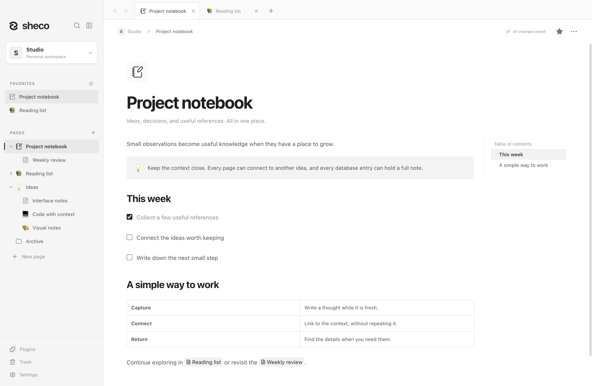
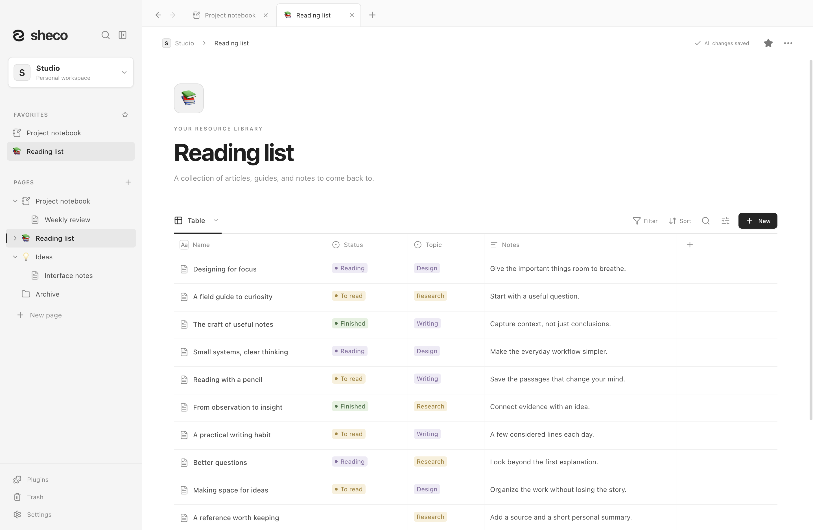
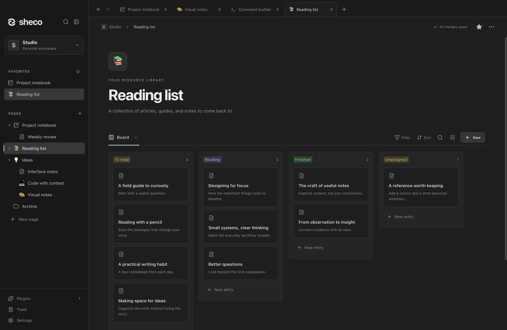
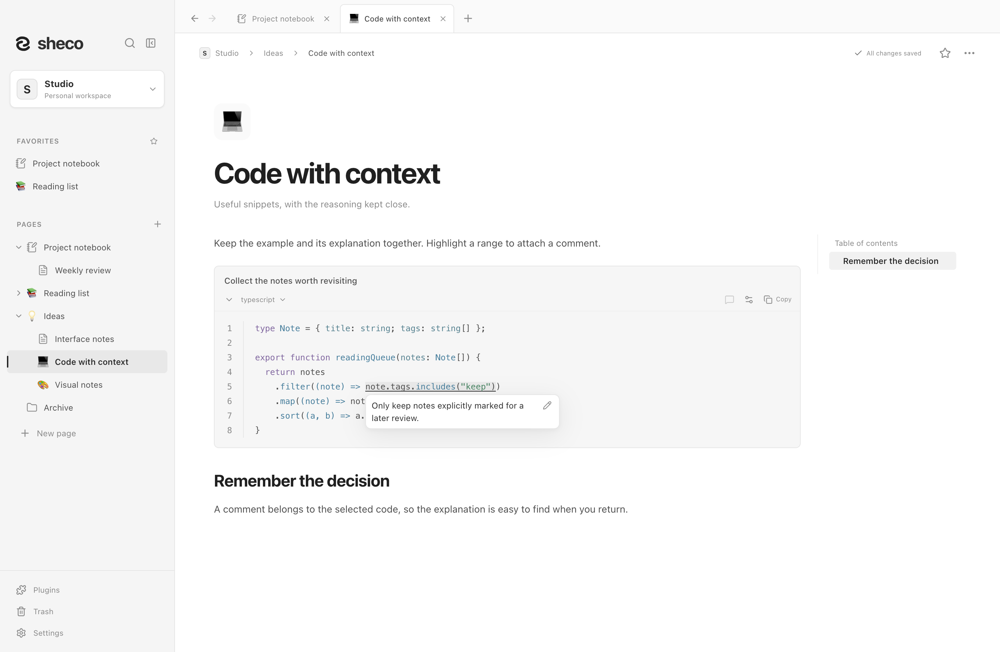
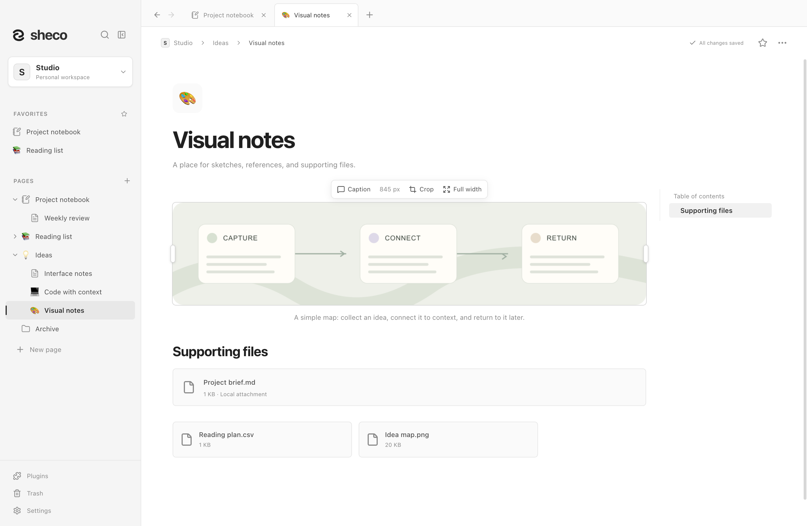
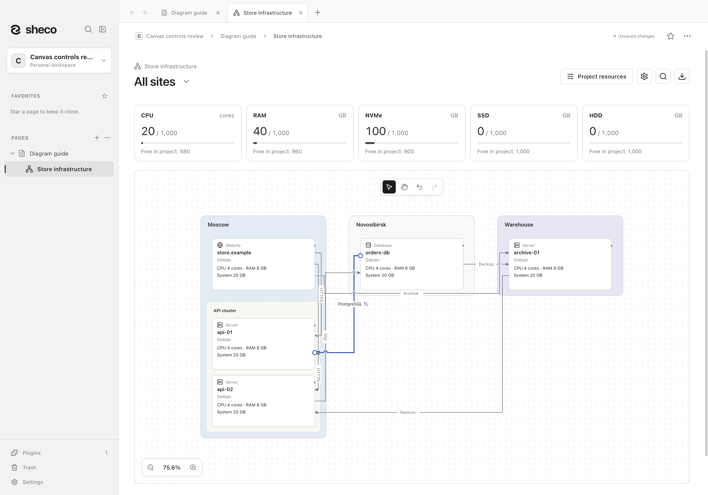
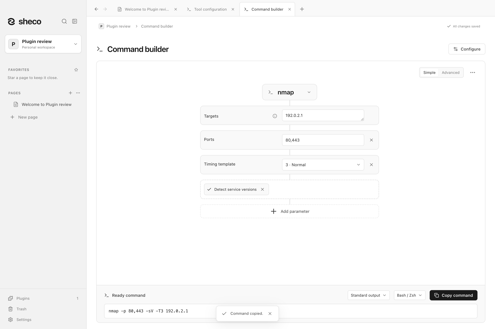

# Sheco

A local home for your knowledge.

Sheco is a desktop knowledge app for **macOS and Windows**. Write notes, connect pages,
organize databases, and keep your documents in folders you own. No account or hosted backend
is required. The interface supports **English and Russian**.

[Русский](README.ru.md) · [User guide](docs/user-guide.md) ·
[Plugins and screenshots](plugins/README.md) · [Documentation](docs/README.md) · [Contributing](CONTRIBUTING.md) ·
[Repository](https://github.com/shecof/Sheco)



## Install

Download [Sheco 1.0.1](https://github.com/shecof/Sheco/releases/tag/v1.0.1):

| Platform            | Downloads                                                                                                                                                                               | Signing                                    |
| ------------------- | --------------------------------------------------------------------------------------------------------------------------------------------------------------------------------------- | ------------------------------------------ |
| macOS Apple Silicon | [DMG](https://github.com/shecof/Sheco/releases/download/v1.0.1/Sheco-1.0.1-mac-arm64.dmg) · [ZIP](https://github.com/shecof/Sheco/releases/download/v1.0.1/Sheco-1.0.1-mac-arm64.zip)   | Developer ID signed and notarized by Apple |
| macOS Intel         | [DMG](https://github.com/shecof/Sheco/releases/download/v1.0.1/Sheco-1.0.1-mac-x64.dmg) · [ZIP](https://github.com/shecof/Sheco/releases/download/v1.0.1/Sheco-1.0.1-mac-x64.zip)       | Developer ID signed and notarized by Apple |
| Windows x64         | [Installer](https://github.com/shecof/Sheco/releases/download/v1.0.1/Sheco-1.0.1-win-x64.exe) · [ZIP](https://github.com/shecof/Sheco/releases/download/v1.0.1/Sheco-1.0.1-win-x64.zip) | Unsigned                                   |

On macOS, open the DMG and drag Sheco to Applications, or extract the ZIP and move the app there.
On Windows, run the installer, or extract the ZIP and open `Sheco.exe`. Windows may show an
unknown-publisher warning because these Windows builds are unsigned.

The release includes `SHA256SUMS.txt` and the checks and platform limits for these exact files.

## Features

- **Connected pages:** nested pages, tabs, favorites, wiki links, backlinks, workspace search,
  and find and replace within a page.
- **Block editor:** rich text, lists and tasks, folds, callouts, code with highlighting and
  comments, math, simple tables, and Mermaid diagrams with a visual editor for basic flowcharts.
- **Local media:** images, galleries, captions, reversible cropping, file attachments, and an optional
  PDF/text/video preview plugin with separate tabs.
- **Databases:** records are complete pages, with typed properties, relations, filters, sorting,
  and table, list, board, and gallery views. Embed a database inside a note.
- **Portable data:** Markdown import/export, CSV database export, PDF page export, and complete
  workspace exports with attachments.
- **Durable saves:** revision checks, atomic replacement, backup checkpoints, recovery,
  and recoverable Trash.
- **Comfortable reading:** light/dark/system appearance, accent colors, page outline,
  reading width and font-size controls.
- **Plugins when you need them:** architecture diagrams and resource budgets, document templates,
  data transformations, file previews, Jira issues, a command builder, and AI access through MCP.
  [Explore all plugins with demonstrations and screenshots](plugins/README.md).
- **Update checks:** check manually in Settings or opt into a startup check, with a link to the
  release page to install the next version.

## A closer look

**Organize a collection.** Use typed properties, status tags, and notes to keep useful references
together. Every database entry opens as a complete page.



**See the same collection as a board.** Switch views to follow progress, with light and dark
themes for your workspace.



**Keep code and its explanation together.** Syntax highlighting, line numbers, and comments
attached to selected ranges make useful snippets easier to revisit.



**Bring images and files into a note.** Add local pictures with captions and keep supporting
documents nearby as file cards or compact attachments.



**Plan a project's architecture.** Place servers, databases and websites on a diagram,
connect them and track resource capacity. Each diagram opens as its own page and stays
visible in your notes through a live preview.
[Explore the architecture plugin](plugins/project-architecture/README.md).



**Build commands with a plugin.** Choose a tool, add parameters, and copy the assembled command
for Bash/Zsh or PowerShell. Open it with `/commands` or the Plugins menu.
The optional command builder never executes commands.
See the [plugin guide](docs/plugins.md) for tool configuration and portable catalogs.



**Keep Jira tasks alongside your notes.** The optional Jira plugin connects to Jira
Server / Data Center using a PAT, or Jira Cloud using an email and API token
(with or without scopes). Connect several servers with separate credentials and choose a server
when inserting an issue. Insert detailed issue cards with
status and due date, or inline key/status references within text and lists. Saved snapshots work
offline; refresh them when needed. See the [plugin catalog and screenshots](plugins/README.md).

Screenshots show the macOS app with fictional demo content. [About the screenshots](docs/screenshots/README.md).

## Project status

Sheco is in active development. This repository contains source code and a macOS/Windows CI
workflow. Source and downloads are available in the public repository's
[Releases](https://github.com/shecof/Sheco/releases).
Linux packaging and runtime verification are not provided.

Check the [CI results](https://github.com/shecof/Sheco/actions) for the revision you use.
A configured CI job or an existing installer is not proof that the current revision passed on
every platform. See [release preparation](docs/releasing.md) for distribution requirements.

## Try it from source

Requires **Node.js 22.12+**, npm, and macOS or Windows. From the project directory:

```sh
npm ci
```

Use a fresh data folder for your first source run, so development stays separate from your usual
Sheco workspaces.

**macOS / POSIX shell**

```sh
sheco_dev_data=$(mktemp -d "${TMPDIR:-/tmp}/sheco-dev.XXXXXX")
SHECO_DATA_DIR="$sheco_dev_data" npm run dev
```

**Windows PowerShell**

```powershell
$shecoDevData = Join-Path ([System.IO.Path]::GetTempPath()) ('sheco-dev-' + [guid]::NewGuid())
New-Item -ItemType Directory -Path $shecoDevData | Out-Null
$env:SHECO_DATA_DIR = $shecoDevData
npm run dev
Remove-Item Env:SHECO_DATA_DIR
```

The first isolated run creates a sample **Knowledge** workspace under that folder's `Knowledge/`
directory. Use the workspace menu to create an empty workspace or open your own folder.
Running `npm run dev` without the override uses normal app data and can create
`Documents/Sheco/Knowledge`. See the [development guide](docs/development/development.md) for preview
and debugging instructions.

## Your data

A workspace contains `workspace.json`, `attachments/`, and recovery metadata. The JSON snapshot
is the source of truth; Markdown and CSV are readable exports, not lossless backups. Use
**Settings → Export workspace** or copy the entire workspace folder after closing its writer.

Documents and backups are **not encrypted**. Third-party folder synchronization does not provide
collaborative editing: edit a workspace on one device at a time. Normal attachment imports are
limited to 200 MiB per file, snapshots to 64 MiB, and MCP file operations to 8 MiB. Search runs in
memory and database views are not virtualized. Read more in the [user guide](docs/user-guide.md)
and [security policy](SECURITY.md).

## Develop and contribute

Built with Electron, React, TypeScript, and Tiptap/ProseMirror.

```sh
npm run check       # Type checking, unit tests, production build
npm run test:e2e    # Electron workflows in a temporary workspace
npm run pack        # Runnable app directory for the current OS
```

The [contribution guide](CONTRIBUTING.md) covers setup, regression checks, and pull requests.
The [testing matrix](docs/development/testing.md) lists focused desktop suites;
the [development guides](docs/development/README.md) describe the implementation.

| Directory   | Purpose                                                                           |
| ----------- | --------------------------------------------------------------------------------- |
| `src/`      | React interface, editor, live state, and shared model/validation/export helpers   |
| `electron/` | Desktop lifecycle, fixed preload API, filesystem storage, and local MCP transport |
| `tests/`    | Unit and regression tests                                                         |
| `scripts/`  | Development, build, packaging helpers, and desktop review suites                  |
| `build/`    | Logo and platform icon assets; dependency notices generated during builds         |
| `plugins/`  | Built-in plugin catalog, usage guides, and demonstration screenshots              |
| `docs/`     | User documentation, development guides, and release preparation                   |
| `.github/`  | CI and contribution templates                                                     |

Dependencies, compiled output, installers, and local test/preview data are excluded from Git.
`test-results/design-preview/` is persistent user data even though it is ignored.

## Security and license

Report vulnerabilities privately to **[shecof@ya.ru](mailto:shecof@ya.ru)**. Do not include
credentials or personal workspaces in public reports. See [SECURITY.md](SECURITY.md).

Sheco is licensed under the [MIT License](LICENSE). Dependencies retain their own licenses;
`npm run notices` generates `build/THIRD_PARTY_NOTICES.txt` for packaged distributions.
