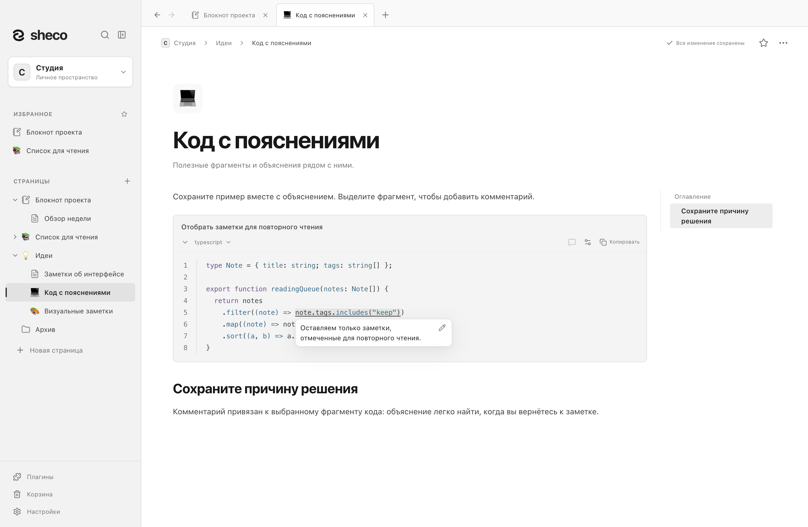
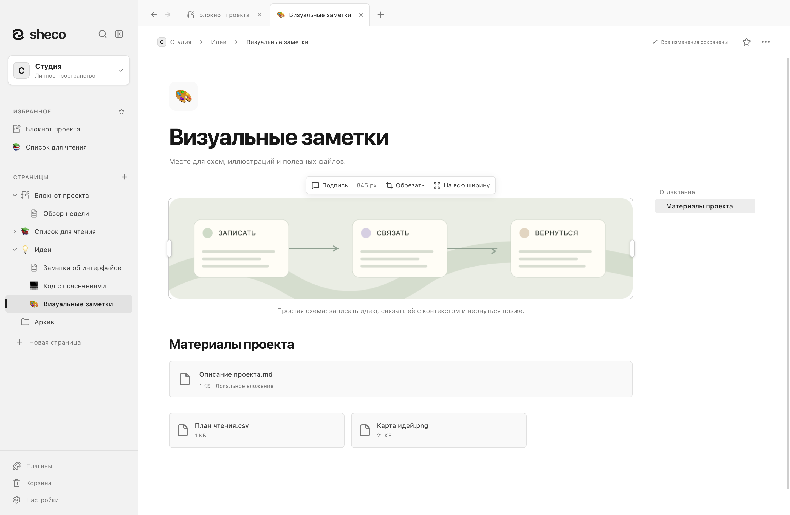
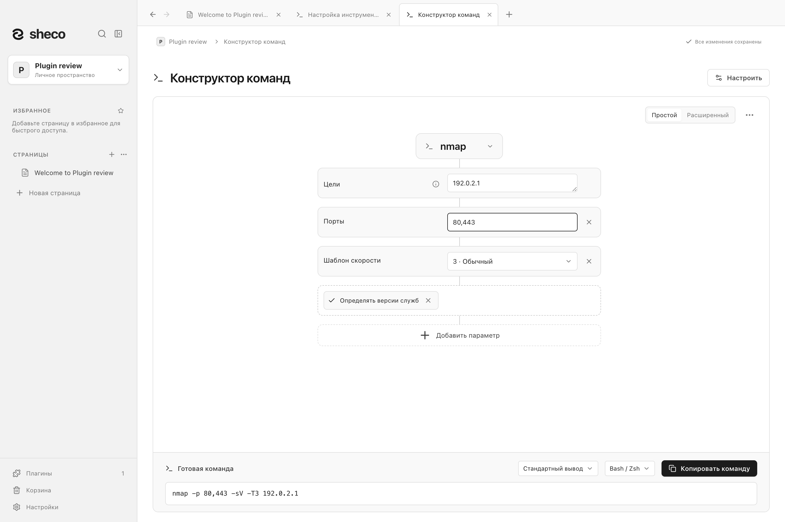

# Sheco

Локальный дом для ваших знаний.

Sheco — приложение для **macOS и Windows**: заметки, связанные страницы и базы данных
в папках, которыми управляете вы. Аккаунт и сервер не нужны. Интерфейс доступен
на **русском и английском** языках.

[English](README.md) · [Руководство пользователя — EN](docs/user-guide.md) ·
[Плагины и скриншоты](plugins/README.md) · [Документация](docs/README.md) · [Участие в разработке — EN](CONTRIBUTING.md) ·
[Репозиторий](https://github.com/shecof/Sheco)


## Установка

Скачайте [Sheco 1.0.1](https://github.com/shecof/Sheco/releases/tag/v1.0.1):

| Платформа           | Файлы                                                                                                                                                                                    | Подпись                            |
| ------------------- | ---------------------------------------------------------------------------------------------------------------------------------------------------------------------------------------- | ---------------------------------- |
| macOS Apple Silicon | [DMG](https://github.com/shecof/Sheco/releases/download/v1.0.1/Sheco-1.0.1-mac-arm64.dmg) · [ZIP](https://github.com/shecof/Sheco/releases/download/v1.0.1/Sheco-1.0.1-mac-arm64.zip)    | Developer ID и нотарификация Apple |
| macOS Intel         | [DMG](https://github.com/shecof/Sheco/releases/download/v1.0.1/Sheco-1.0.1-mac-x64.dmg) · [ZIP](https://github.com/shecof/Sheco/releases/download/v1.0.1/Sheco-1.0.1-mac-x64.zip)        | Developer ID и нотарификация Apple |
| Windows x64         | [Установщик](https://github.com/shecof/Sheco/releases/download/v1.0.1/Sheco-1.0.1-win-x64.exe) · [ZIP](https://github.com/shecof/Sheco/releases/download/v1.0.1/Sheco-1.0.1-win-x64.zip) | Без подписи                        |

На macOS откройте DMG и перенесите Sheco в Applications либо распакуйте ZIP и перенесите
приложение туда. На Windows запустите установщик либо распакуйте ZIP и откройте `Sheco.exe`.
Windows может показать предупреждение о неизвестном издателе: Windows-сборки пока не подписаны.

В релизе есть `SHA256SUMS.txt`, результаты проверок и ограничения по платформам для этих файлов.

## Возможности

- **Связанные страницы:** вложенность, вкладки, избранное, wiki-ссылки, обратные ссылки,
  поиск по пространству и поиск с заменой на странице.
- **Блочный редактор:** форматирование текста, списки и задачи, сворачиваемые разделы,
  выноски, код с подсветкой и комментариями, формулы, таблицы и Mermaid-диаграммы
  с визуальным редактором простых блок-схем.
- **Локальные файлы:** изображения, галереи, подписи, обратимая обрезка и вложения;
  плагин предпросмотра PDF, текстовых файлов и видео в отдельных вкладках.
- **Базы данных:** записи являются полноценными страницами; доступны типизированные свойства,
  связи, фильтры, сортировка, таблица, список, доска и галерея. Базу можно встроить в заметку.
- **Переносимость:** импорт и экспорт Markdown, экспорт баз в CSV, страниц в PDF,
  полных рабочих пространств вместе с вложениями.
- **Сохранность:** атомарное сохранение, контроль версий снимка, резервные точки,
  восстановление и Корзина.
- **Настройки чтения:** светлая, тёмная и системная темы, акцентные цвета, оглавление,
  ширина страницы и размер текста.
- **Плагины по необходимости:** схемы архитектуры и учёт ресурсов, шаблоны документов,
  обработка данных, предпросмотр файлов, задачи Jira, конструктор команд и подключение ИИ через MCP.
  [Откройте каталог плагинов с демонстрациями и скриншотами](plugins/README.md).
- **Проверка обновлений:** ручная проверка в настройках или проверка при запуске по вашему выбору,
  со ссылкой на релиз для установки новой версии.

## Посмотрите на приложение

**Организуйте коллекцию.** Свойства, статусы и заметки помогают держать полезные материалы
вместе. Каждая запись базы открывается как полноценная страница.


**Переключитесь на доску.** Следите за ходом работы в другом представлении той же коллекции.
Для рабочего пространства доступны светлая и тёмная темы.


**Сохраните код вместе с объяснением.** Подсветка синтаксиса, номера строк и комментарии
к выбранным фрагментам помогают вернуться к полезному примеру.



**Добавьте изображения и файлы в заметку.** Иллюстрации с подписями и документы в виде
карточек или компактных вложений остаются рядом с текстом.



**Спланируйте архитектуру проекта.** Разместите серверы, базы и сайты на схеме,
свяжите их стрелками и проверьте запас ресурсов. Схема открывается отдельной страницей
и остаётся видна в заметке через живой предпросмотр.
[Подробнее об архитектуре](plugins/project-architecture/README.md).


**Соберите команду в плагине.** Выберите инструмент, добавьте параметры и скопируйте команду
для Bash/Zsh или PowerShell. Откройте его через `/commands` или меню Плагины.
Конструктор включается отдельно и не выполняет команды.
Настройка инструментов и перенос каталогов описаны в [руководстве по плагинам](docs/plugins.md).



**Храните задачи Jira рядом с заметками.** Плагин подключается к Jira Server / Data Center
через PAT и Jira Cloud через email и API-токен с scopes или без них. Подключайте несколько серверов
с отдельными токенами и выбирайте сервер при вставке задачи. Добавляйте подробные карточки со статусом и сроком или
вставки с ключом и статусом задачи прямо в текст и списки. Сохранённые снимки доступны без сети и обновляются
по нажатию. См. [каталог плагинов с описаниями и скриншотами](plugins/README.md).

На скриншотах — приложение для macOS с вымышленными демонстрационными данными.
[О скриншотах — EN](docs/screenshots/README.md).

## Состояние проекта

Проект активно разрабатывается. Есть исходники и конфигурация CI для macOS и Windows;
исходники и загрузки доступны в публичном репозитории и
[Releases](https://github.com/shecof/Sheco/releases).
Сборка и проверка работы в Linux не предусмотрены.

Проверяйте [результаты CI](https://github.com/shecof/Sheco/actions) для нужной ревизии.
Наличие CI или старого установщика не подтверждает работу текущей версии на всех платформах.
Требования к распространению описаны в [подготовке релиза](docs/releasing.md).

## Запуск из исходников

Нужны **Node.js 22.12+**, npm и macOS или Windows. В каталоге проекта:

```sh
npm ci
```

Для первого запуска выделите отдельную папку данных, чтобы разработка использовала
собственное рабочее пространство.

**macOS / POSIX**

```sh
sheco_dev_data=$(mktemp -d "${TMPDIR:-/tmp}/sheco-dev.XXXXXX")
SHECO_DATA_DIR="$sheco_dev_data" npm run dev
```

**Windows PowerShell**

```powershell
$shecoDevData = Join-Path ([System.IO.Path]::GetTempPath()) ('sheco-dev-' + [guid]::NewGuid())
New-Item -ItemType Directory -Path $shecoDevData | Out-Null
$env:SHECO_DATA_DIR = $shecoDevData
npm run dev
Remove-Item Env:SHECO_DATA_DIR
```

При первом изолированном запуске пример **Knowledge** создаётся в `Knowledge/` внутри
указанной папки. Через меню рабочих пространств можно создать пустое пространство
или открыть своё. Без `SHECO_DATA_DIR` команда `npm run dev` использует обычные данные
приложения и может создать `Documents/Sheco/Knowledge`.
Подробнее — в [руководстве разработчика](docs/development/development.md).

## Хранение данных

Рабочее пространство содержит `workspace.json`, `attachments/` и метаданные восстановления.
JSON-снимок — основной формат хранения. Markdown и CSV не заменяют полную резервную копию.
Используйте **Настройки → Экспорт рабочего пространства** или копируйте всю папку,
предварительно закрыв приложение, которое её редактирует.

Документы и резервные копии **не зашифрованы**. Синхронизация папки сторонними средствами
не обеспечивает совместное редактирование: работайте с пространством на одном устройстве
за раз. Лимит одного вложения — 200 МиБ, снимка — 64 МиБ, файловой операции MCP — 8 МиБ.
Поиск работает в памяти; представления баз не используют виртуализацию.
См. [подробное руководство](docs/user-guide.md), [плагины и формат JSON](docs/plugins.md)
и [политику безопасности](SECURITY.md).

## Разработка и участие

Стек: Electron, React, TypeScript и Tiptap/ProseMirror.

```sh
npm run check       # Проверка типов, модульные тесты, сборка исходников
npm run test:e2e    # Проверка Electron в отдельном временном пространстве
npm run pack        # Каталог приложения для текущей ОС
```

Порядок работы описан в [CONTRIBUTING.md](CONTRIBUTING.md), выбор проверок —
в [матрице тестирования](docs/development/testing.md). Устройство проекта описано
в [руководствах разработчика](docs/development/README.md).

| Каталог     | Назначение                                                           |
| ----------- | -------------------------------------------------------------------- |
| `src/`      | Интерфейс, редактор, состояние, общая модель и экспорт               |
| `electron/` | Жизненный цикл приложения, preload API, хранение и MCP               |
| `tests/`    | Модульные и регрессионные тесты                                      |
| `scripts/`  | Запуск, сборка, вспомогательные операции и проверки приложения       |
| `build/`    | Логотип, иконки платформ и генерируемые уведомления о лицензиях      |
| `plugins/`  | Каталог встроенных плагинов, инструкции и демонстрационные скриншоты |
| `docs/`     | Руководства, инструкции разработчика и подготовка релизов            |
| `.github/`  | CI и шаблоны обсуждений изменений                                    |

Зависимости, результаты сборки, установщики и локальные данные исключены из Git.
`test-results/design-preview/` остаётся постоянным пользовательским пространством,
несмотря на исключение из Git.

## Безопасность и лицензия

Об уязвимостях сообщайте приватно: **[shecof@ya.ru](mailto:shecof@ya.ru)**.
Не публикуйте ключи доступа и личные рабочие пространства. См. [SECURITY.md](SECURITY.md).

Проект распространяется по [лицензии MIT](LICENSE). Зависимости сохраняют собственные
лицензии; `npm run notices` создаёт `build/THIRD_PARTY_NOTICES.txt` для дистрибутивов.
