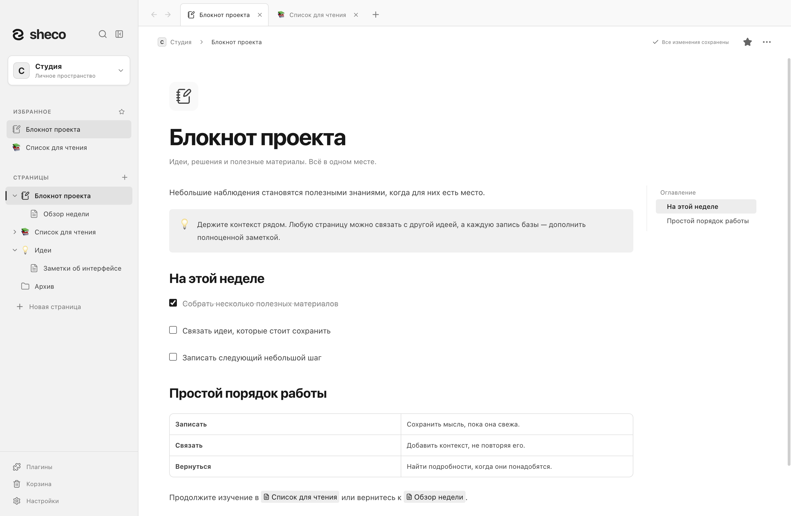
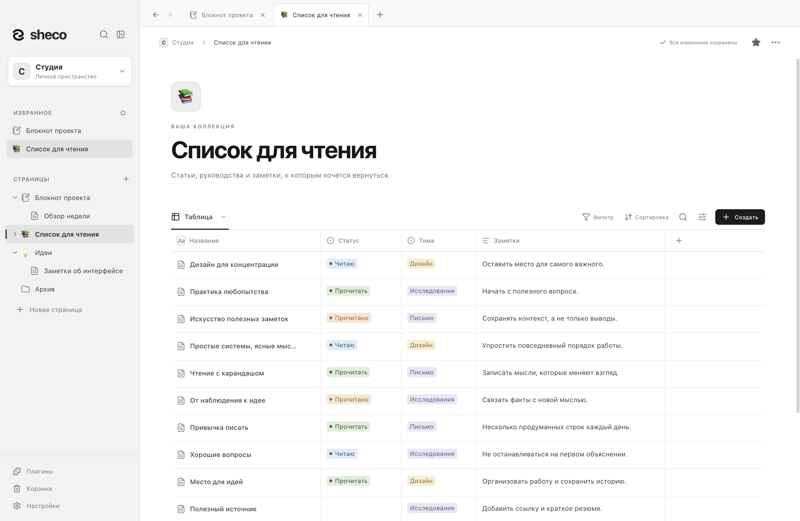
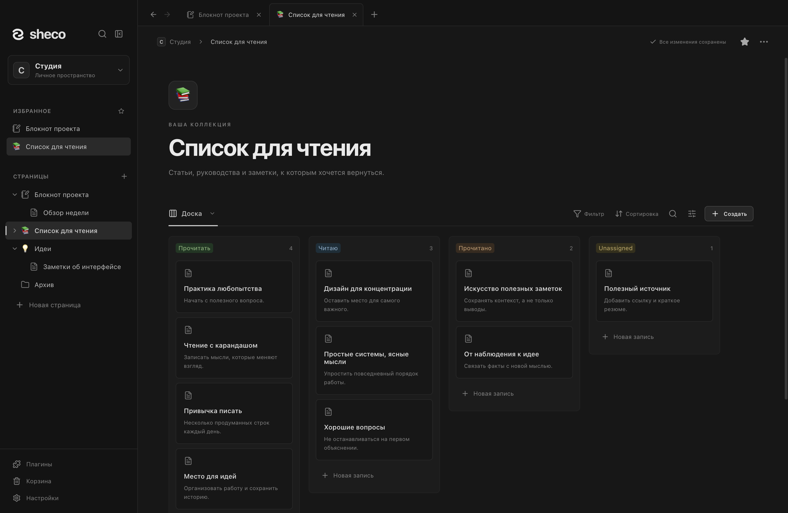

# Sheco

Локальный дом для ваших знаний.

Sheco — приложение для **macOS и Windows**: заметки, связанные страницы и базы данных
в папках, которыми управляете вы. Аккаунт и сервер не нужны. Интерфейс доступен
на **русском и английском** языках.

[English](README.md) · [Руководство пользователя — EN](docs/user-guide.md) ·
[Документация](docs/README.md) · [Участие в разработке — EN](CONTRIBUTING.md) ·
[Репозиторий](https://github.com/shecof/Sheco)



## Возможности

- **Связанные страницы:** вложенность, вкладки, избранное, wiki-ссылки, обратные ссылки,
  поиск по пространству и поиск с заменой на странице.
- **Блочный редактор:** форматирование текста, списки и задачи, сворачиваемые разделы,
  выноски, код с подсветкой и комментариями, формулы, таблицы и Mermaid-диаграммы
  с визуальным редактором простых блок-схем.
- **Локальные файлы:** изображения, галереи, подписи, обратимая обрезка и вложения.
- **Базы данных:** записи являются полноценными страницами; доступны типизированные свойства,
  связи, фильтры, сортировка, таблица, список, доска и галерея. Базу можно встроить в заметку.
- **Переносимость:** импорт и экспорт Markdown, экспорт баз в CSV, страниц в PDF,
  полных рабочих пространств вместе с вложениями.
- **Сохранность:** атомарное сохранение, контроль версий снимка, резервные точки,
  восстановление и Корзина.
- **Дополнительные интеграции:** локальный MCP с авторизацией для ИИ-клиентов и настраиваемый
  конструктор команд. MCP по умолчанию выключен; конструктор копирует команды и не запускает их.
- **Настройки чтения:** светлая, тёмная и системная темы, акцентные цвета, оглавление,
  ширина страницы и размер текста.

## Посмотрите на приложение

**Организуйте коллекцию.** Свойства, статусы и заметки помогают держать полезные материалы
вместе. Каждая запись базы открывается как полноценная страница.



**Переключитесь на доску.** Следите за ходом работы в другом представлении той же коллекции.
Для рабочего пространства доступны светлая и тёмная темы.



На скриншотах — приложение для macOS с вымышленными демонстрационными данными.
[О скриншотах — EN](docs/screenshots/README.md).

## Состояние проекта

Проект активно разрабатывается. Есть исходники и конфигурация CI для macOS и Windows;
репозиторий пока приватный, публичные установщики ещё не опубликованы.
Ниже описан запуск из исходников.
Сборка и проверка работы в Linux не предусмотрены.

Проверяйте [результаты CI](https://github.com/shecof/Sheco/actions) для нужной ревизии.
Наличие CI или старого установщика не подтверждает работу текущей версии на всех платформах.
Требования к распространению описаны в [подготовке релиза](docs/releasing.md).

## Запуск из исходников

Нужны **Node.js 22.12+**, npm и macOS или Windows. В каталоге проекта:

```sh
npm ci
```

Для первого запуска выделите отдельную папку данных, чтобы разработка использовала
собственное рабочее пространство.

**macOS / POSIX**

```sh
sheco_dev_data=$(mktemp -d "${TMPDIR:-/tmp}/sheco-dev.XXXXXX")
SHECO_DATA_DIR="$sheco_dev_data" npm run dev
```

**Windows PowerShell**

```powershell
$shecoDevData = Join-Path ([System.IO.Path]::GetTempPath()) ('sheco-dev-' + [guid]::NewGuid())
New-Item -ItemType Directory -Path $shecoDevData | Out-Null
$env:SHECO_DATA_DIR = $shecoDevData
npm run dev
Remove-Item Env:SHECO_DATA_DIR
```

При первом изолированном запуске пример **Pentest** создаётся в `Knowledge/` внутри
указанной папки. Через меню рабочих пространств можно создать пустое пространство
или открыть своё. Без `SHECO_DATA_DIR` команда `npm run dev` использует обычные данные
приложения и может создать `Documents/Sheco/Pentest`.
Подробнее — в [руководстве разработчика](docs/development/development.md).

## Хранение данных

Рабочее пространство содержит `workspace.json`, `attachments/` и метаданные восстановления.
JSON-снимок — основной формат хранения. Markdown и CSV не заменяют полную резервную копию.
Используйте **Настройки → Экспорт рабочего пространства** или копируйте всю папку,
предварительно закрыв приложение, которое её редактирует.

Документы и резервные копии **не зашифрованы**. Синхронизация папки сторонними средствами
не обеспечивает совместное редактирование: работайте с пространством на одном устройстве
за раз. Лимит одного вложения — 200 МиБ, снимка — 64 МиБ, файловой операции MCP — 8 МиБ.
Поиск работает в памяти; представления баз не используют виртуализацию.
См. [подробное руководство](docs/user-guide.md), [плагины и формат JSON](docs/plugins.md)
и [политику безопасности](SECURITY.md).

## Разработка и участие

Стек: Electron, React, TypeScript и Tiptap/ProseMirror.

```sh
npm run check       # Проверка типов, модульные тесты, сборка исходников
npm run test:e2e    # Проверка Electron в отдельном временном пространстве
npm run pack        # Каталог приложения для текущей ОС
```

Порядок работы описан в [CONTRIBUTING.md](CONTRIBUTING.md), выбор проверок —
в [матрице тестирования](docs/development/testing.md). Устройство проекта описано
в [руководствах разработчика](docs/development/README.md).

| Каталог     | Назначение                                                      |
| ----------- | --------------------------------------------------------------- |
| `src/`      | Интерфейс, редактор, состояние, общая модель и экспорт          |
| `electron/` | Жизненный цикл приложения, preload API, хранение и MCP          |
| `tests/`    | Модульные и регрессионные тесты                                 |
| `scripts/`  | Запуск, сборка, вспомогательные операции и проверки приложения  |
| `build/`    | Логотип, иконки платформ и генерируемые уведомления о лицензиях |
| `docs/`     | Руководства, инструкции разработчика и подготовка релизов       |
| `.github/`  | CI и шаблоны обсуждений изменений                               |

Зависимости, результаты сборки, установщики и локальные данные исключены из Git.
`test-results/design-preview/` остаётся постоянным пользовательским пространством,
несмотря на исключение из Git.

## Безопасность и лицензия

Об уязвимостях сообщайте приватно: **[shecof@ya.ru](mailto:shecof@ya.ru)**.
Не публикуйте ключи доступа и личные рабочие пространства. См. [SECURITY.md](SECURITY.md).

Проект распространяется по [лицензии MIT](LICENSE). Зависимости сохраняют собственные
лицензии; `npm run notices` создаёт `build/THIRD_PARTY_NOTICES.txt` для дистрибутивов.
