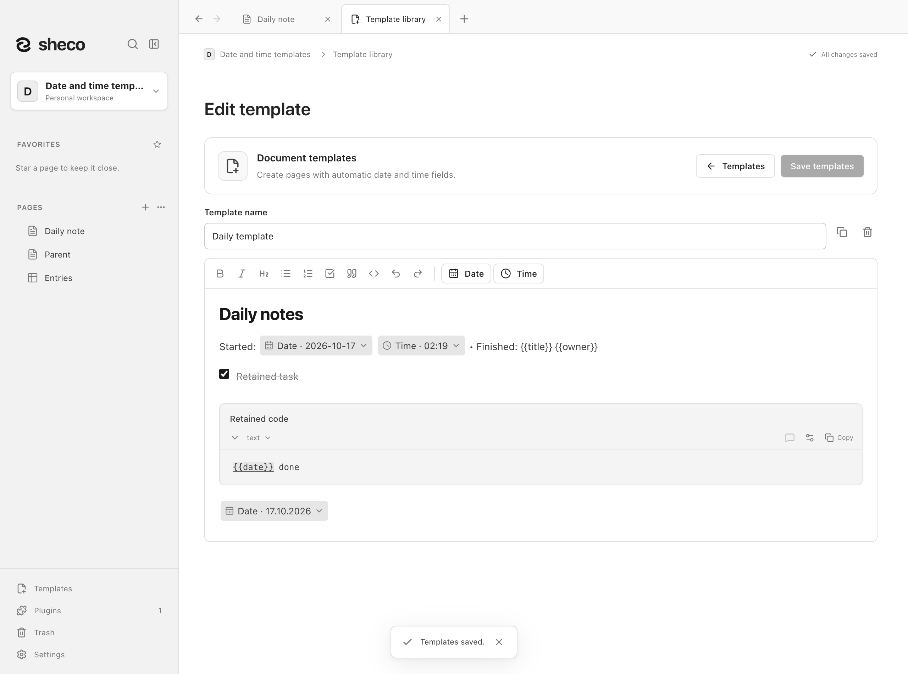
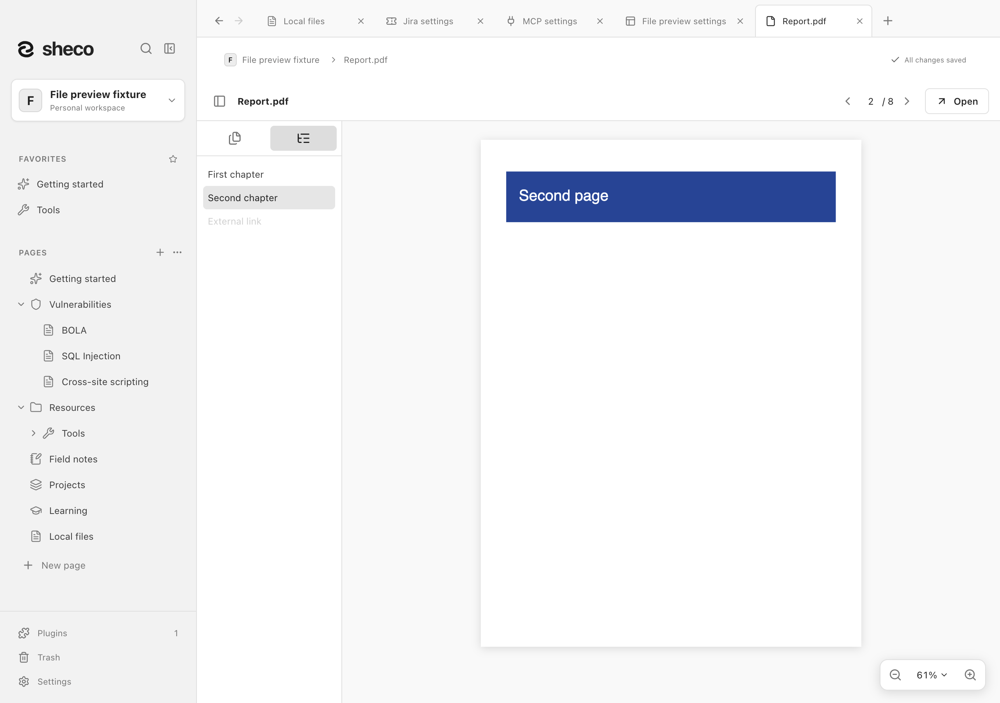
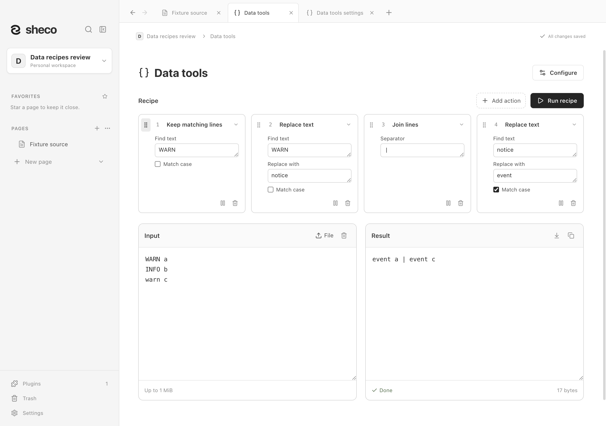
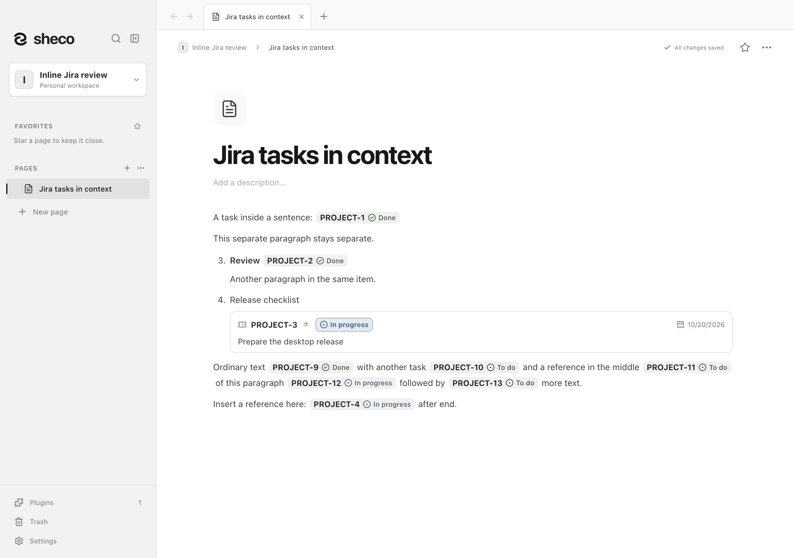
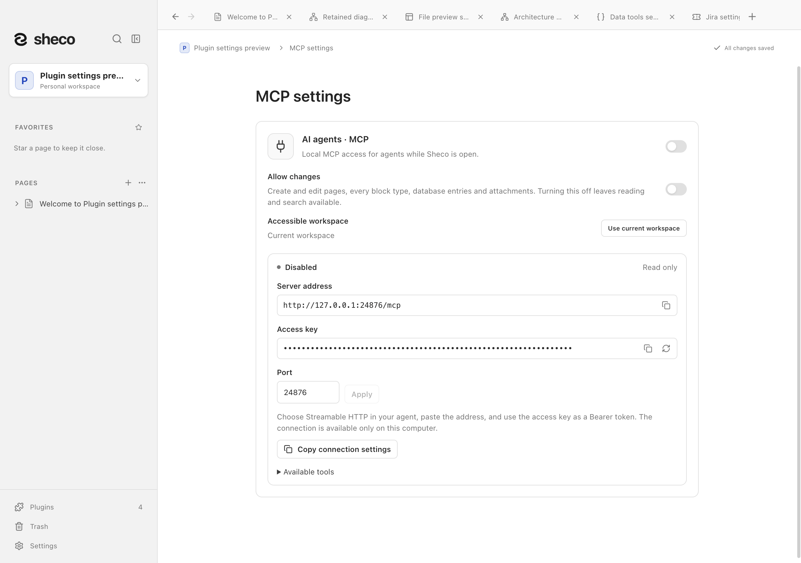

# Плагины Sheco / Sheco plugins

В **Настройки → Плагины** доступен каталог плагинов. Категории **Документы**,
**Инструменты** и **Интеграции** помогают выбрать нужные; **Все плагины** показывает весь
каталог. Плагины рабочего пространства включаются отдельно. Эта папка содержит описания
и скриншоты всех доступных плагинов.

**Settings → Plugins** groups available plugins into **Documents**, **Tools**
and **Integrations**, with an **All plugins** filter. Workspace plugins are enabled separately;
this folder documents every available plugin.

| Плагин / Plugin                            | Возможности / Features                                                                                                                              | Документация / Documentation                           |
| ------------------------------------------ | --------------------------------------------------------------------------------------------------------------------------------------------------- | ------------------------------------------------------ |
| Jira                                       | Блоки задач: подробный и минимальный вид, Server/DC через PAT, Cloud через email/API-токен / Issue blocks, Server/DC PAT and Cloud email/API tokens | [Jira](jira/README.md)                                 |
| Конструктор команд / Command builder       | Сборка и копирование команд для девяти инструментов / Assemble and copy commands for nine tools                                                     | [Command builder](command-builder/README.md)           |
| ИИ-агенты · MCP / AI agents · MCP          | Локальное подключение ИИ-клиентов, чтение и разрешаемая запись / Local AI connection with optional writes                                           | [MCP](mcp/README.md)                                   |
| Предпросмотр файлов / File preview         | PDF, текст и видео во вкладках / PDFs, text and videos in tabs                                                                                      | [File preview](file-preview/README.md)                 |
| Работа с данными / Data tools              | Форматирование, кодировки, хеши и текст / Formatting, encodings, hashes and text                                                                    | [Data tools](data-tools/README.md)                     |
| Архитектура проекта / Project architecture | Площадки, ресурсы, группировки объектов, связи и экспорт / Sites, resources, object groups, connections and exports                                 | [Project architecture](project-architecture/README.md) |
| Шаблоны документов / Document templates    | Копии страниц с автозаполняемыми датой и временем / Page copies with automatic date and time                                                        | [Document templates](document-templates/README.md)     |

## Демонстрации / Demonstrations

### Архитектура проекта / Project architecture

Планируйте площадки, серверы, базы и сайты на свободном полотне. Группируйте объекты,
соединяйте их стрелками и следите за общим запасом CPU, RAM и дисков. Схема — отдельная
страница с живым предпросмотром в заметке; экспортируйте её в SVG, Mermaid, PNG или JPG.

Plan sites, servers, databases and websites on a free canvas, with groups, connections and
shared CPU/RAM/storage budgets. Each diagram is a page with a live preview inside your notes.

[Как пользоваться / Usage and more screenshots →](project-architecture/README.md)

### Шаблоны документов / Document templates

Превратите страницу в шаблон для встреч, инструкций или ежедневных заметок. При создании
новой страницы поля даты и времени заполнятся автоматически; исходный шаблон сохранится.

Turn a page into a reusable meeting, procedure or journal template. Date/time fields fill
when you create a page, while the original template stays in your library.

[Как пользоваться / Usage and more screenshots →](document-templates/README.md)

### Предпросмотр файлов / File preview

Читайте PDF с оглавлением и миниатюрами, открывайте текст и смотрите видео во вкладках
рядом с заметками. Вложения остаются в рабочем пространстве.

Read PDFs with outlines and thumbnails, inspect text and watch videos in tabs beside your
notes. Attachments stay in your workspace.

[Как пользоваться / Usage and more screenshots →](file-preview/README.md)

### Работа с данными / Data tools

Форматируйте JSON, XML и CSV, меняйте кодировки, считайте хеши и очищайте текст цепочкой
шагов. Вводите текст или выбирайте файл; обработка выполняется локально.

Format JSON, XML and CSV, convert encodings, calculate hashes and clean text in ordered
recipes. Work with text or a selected file; processing stays local.

[Как пользоваться / Usage and more screenshots →](data-tools/README.md)

### Jira

Вставляйте задачи карточками или компактными ссылками внутри текста. Подключайте несколько
Jira Server / Data Center и Cloud; сохранённые снимки доступны без сети и обновляются по запросу.

Insert issue cards or compact inline references. Connect multiple Jira Server / Data Center
and Cloud instances; saved snapshots remain readable offline and refresh on request.

[Как пользоваться / Usage and more screenshots →](jira/README.md)

### Конструктор команд / Command builder

Выбирайте инструмент и параметры, затем копируйте готовую команду для Bash/Zsh или PowerShell.
Конструктор содержит девять инструментов и поддерживает собственные каталоги. Команды не выполняются.

Choose a tool and parameters, then copy the assembled command for Bash/Zsh or PowerShell.
Nine tools are included, with support for custom catalogs. The builder never runs commands.

[Как пользоваться / Usage and more screenshots →](command-builder/README.md)

### ИИ-агенты · MCP / AI agents · MCP

Подключите ИИ-клиент к одному выбранному рабочему пространству через локальный MCP.
Плагин по умолчанию выключен, запись разрешается отдельно. Для подключения Sheco должен быть открыт.

Connect an AI client to one selected workspace over local MCP. Access starts disabled, with
writes enabled separately. Sheco must stay open for the connection to work.

[Как пользоваться / Usage and more screenshots →](mcp/README.md)

## О скриншотах / About the screenshots

Скриншоты сделаны в настоящем приложении macOS в изолированных пространствах с вымышленными
данными. Jira использует локальный тестовый REST-сервис. Изображения не подтверждают работу
на Windows или подключение к корпоративному серверу Jira.

Screenshots show the actual macOS app with isolated, synthetic data. Jira uses a local test
REST service. Images do not prove Windows runtime behavior or connectivity to a real Jira account.

Для обновления изображений сначала выполните `npm run build`, затем нужную проверку:
`npm run test:architecture`, `npm run test:document-tools`, `npm run test:file-preview`,
`npm run test:jira`, `npm run test:jira-inline`, `npm run test:plugins` или `npm run test:mcp`.
Проверьте исходные PNG в соответствующей папке `test-results/` перед копированием сюда.
Не используйте пользовательский preview. / Build first, run the relevant isolated review,
then inspect the original PNGs before copying them here. Never use the persistent user preview.

[Руководство по плагинам / Plugin guide](../docs/plugins.md) ·
[Главная / Home](../README.md) · [Главная на русском / Russian home](../README.ru.md)
