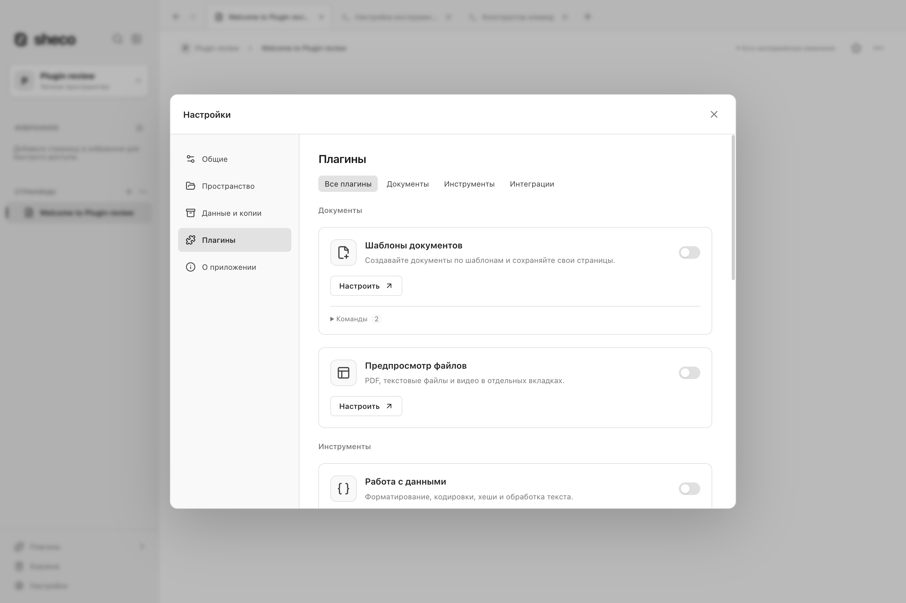
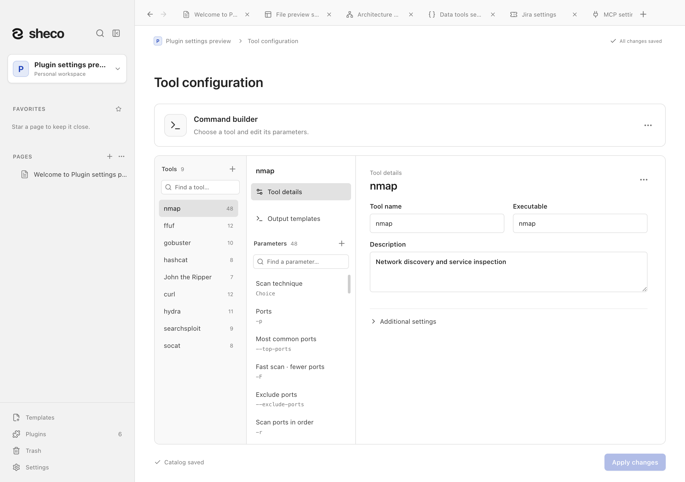
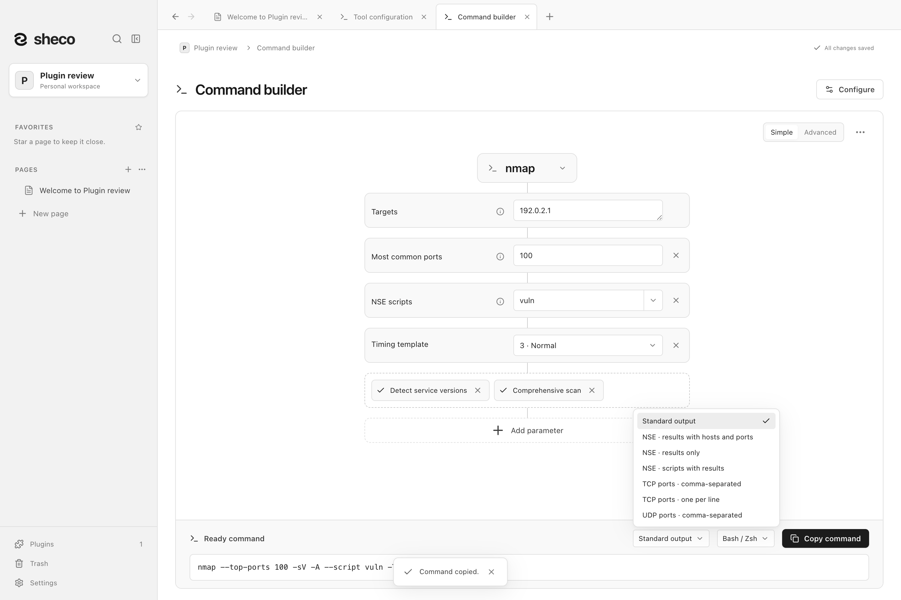
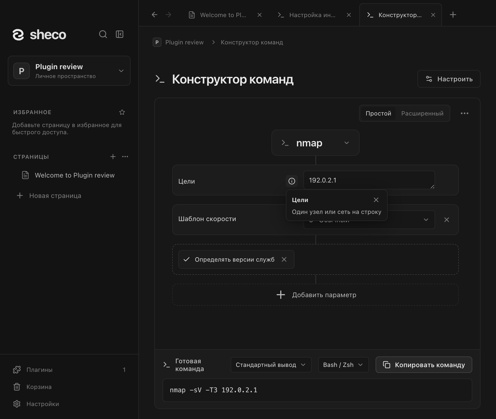
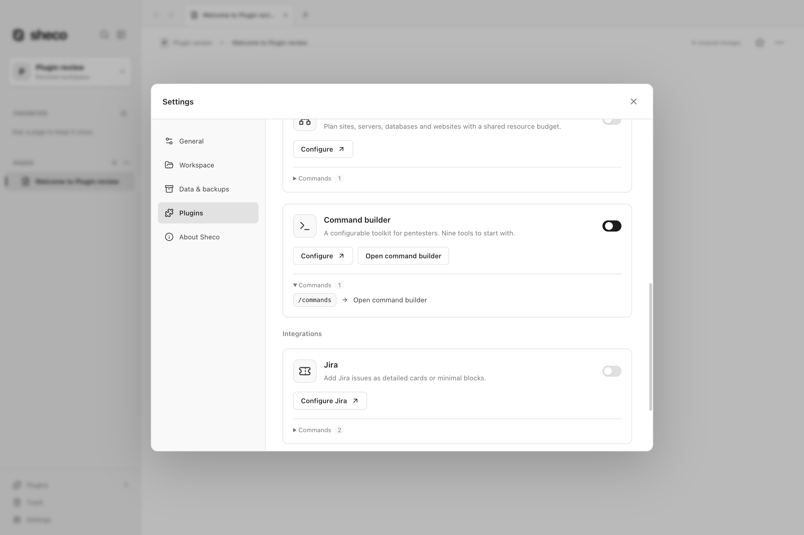

# Конструктор команд / Command builder

Конструктор помогает собрать и скопировать команду для **nmap, ffuf, gobuster,
hashcat, John the Ripper, curl, hydra, searchsploit и socat**. Он не устанавливает
и не запускает инструменты.

Включите **Конструктор команд** в **Настройки → Плагины**, затем откройте его через
меню **Плагины** внизу боковой панели или командой `/commands` на странице.
Карточка плагина показывает оба способа открытия. В простом режиме добавляйте нужные параметры
по одному; расширенный показывает весь каталог. Выберите Bash/Zsh или PowerShell
и скопируйте команду. Значения остаются в текущем сеансе, а каталог инструментов
сохраняется в рабочем пространстве. Настройка каталога открывается в отдельной вкладке.
Кнопка **Настроить** в заголовке открывает этот редактор, сохраняя текущую команду.
Подсказки info компактны. В меню вывода nmap есть результаты NSE с узлами и портами,
только результаты и уникальные имена скриптов с результатами. При выборе NSE эти варианты
показаны первыми; шаблоны рассчитаны на обычный текстовый вывод и Bash/Zsh.

Подробности о параметрах, подсказках, шаблонах вывода и переносимом формате JSON:
[руководство по плагинам](../../docs/plugins.md).

## English

Enable **Command builder** in **Settings → Plugins** and open it from the sidebar's
**Plugins** menu or type `/commands` on a page. The plugin card lists both actions. Choose one of the nine tools, add parameters in Simple mode or
inspect the full catalog in Advanced mode, then copy the command for Bash/Zsh or
PowerShell. Commands are never executed. Entered values stay in the current session;
the editable tool catalog is saved per workspace and can be shared as validated JSON.
Configuration opens in its own tab. See the [plugin guide](../../docs/plugins.md).
The tool catalog settings above use the same icon, typography and spacing as other plugins.
The builder header's **Configure** button opens that editor and retains the current command.
Info popovers fit their text. Nmap offers NSE results with host/port context, results only and
unique script names with results; script scanning puts these choices first. These templates
process normal text output in Bash/Zsh.

