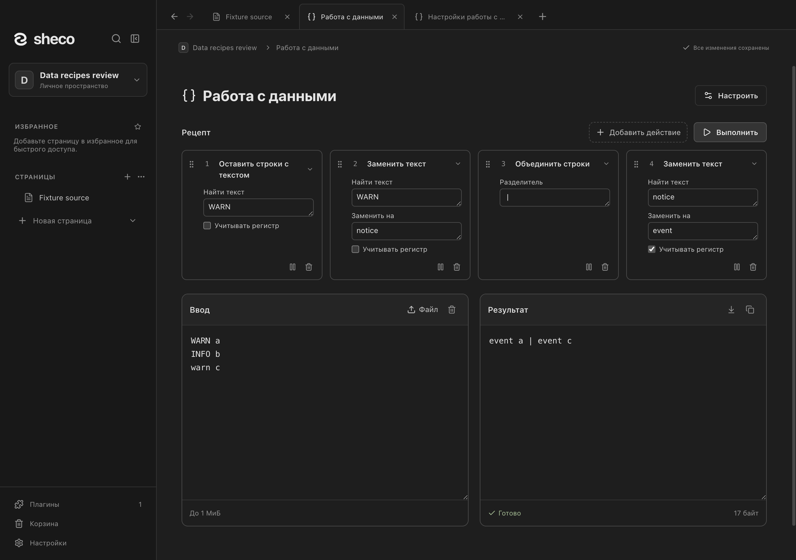
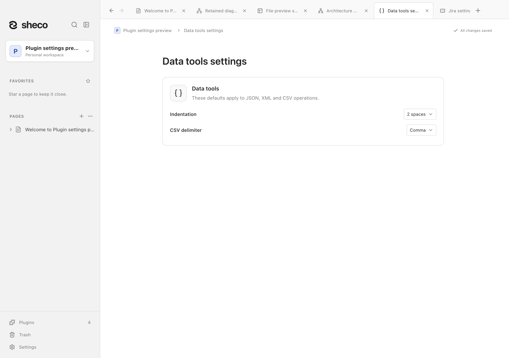

# Работа с данными / Data tools

Включите плагин в **Настройки → Плагины → Инструменты**, затем откройте через меню
**Плагины** или `/data`.

1. Вставьте текст в **Ввод** или нажмите **Файл**, чтобы выбрать файл до 1 МиБ.
2. Соберите **Рецепт** в горизонтальной полосе над вводом и результатом. **Добавить действие** открывает поиск
   и категории; нажатие на название шага меняет его действие.
3. Результат обновляется при изменениях. **Выполнить** и Ctrl/⌘+Enter запускают рецепт сразу.

Действия выполняются в порядке нумерации. Пауза временно пропускает отдельный шаг, сохраняя его
на месте; повторное нажатие возобновляет его. Перетаскивайте шаг за видимую ручку,
чтобы изменить порядок. Кнопка удаления находится на карточке. Для клавиатуры доступны
стрелки, Home и End на сфокусированной ручке. Ошибка указывает на шаг и не выдаёт промежуточный результат за готовый.
Кнопки в заголовке результата копируют его или переносят во ввод. **Очистить** удаляет
ввод, выбранный файл и результат; рецепт сохраняется. Успешный пустой результат тоже можно
скопировать. В узком окне поля стоят друг под другом под рецептом; карточки шагов
переносятся на следующие строки, сохраняя ширину полей.

Хеши, кодирование Base64/Base64url и hex используют исходные байты файла, включая BOM
и переводы строк. Форматирование и прочие текстовые действия требуют UTF-8; файл показан
только для чтения. Кнопка **Убрать файл** возвращает прежний текстовый ввод.

| Группа / Group              | Операции / Operations                                                                                                                                                    |
| --------------------------- | ------------------------------------------------------------------------------------------------------------------------------------------------------------------------ |
| Форматирование / Formatting | JSON и XML: форматировать и сжать / JSON and XML format and minify                                                                                                       |
| Таблицы / Tables            | CSV → JSON, JSON → CSV                                                                                                                                                   |
| Кодировки / Encodings       | Base64, Base64url, URL-компонент, hex UTF-8, HTML-сущности: кодировать и декодировать / Encode and decode Base64, Base64url, URL components, UTF-8 hex and HTML entities |
| Хеши / Hashes               | SHA-1, SHA-256, SHA-512, CRC-32                                                                                                                                          |
| Текст / Text                | Сортировать строки, удалить повторы, обрезать пробелы, статистика / Sort lines, remove duplicates, trim whitespace, text counts                                          |

Дополнительные действия:

- Проверить JSON без изменения текста; преобразовать текст в строку JSON и обратно;
  массив JSON ↔ JSON Lines с сохранением чисел и повторяющихся ключей.
- Верхний/нижний регистр, удаление пробелов вокруг текста, сжатие пробелов,
  нормализация Unicode (NFC/NFD/NFKC/NFKD), переводы строк LF/CRLF.
- Удаление пустых строк, обратный порядок, естественная сортировка чисел внутри строк,
  сохранение или удаление строк с указанным текстом.
- Буквальная замена всех совпадений, разделение текста на строки, объединение разделителем,
  добавление префикса и суффикса каждой строке.
- CRC-32 для текста и исходных байтов файла.

Параметры находятся в карточке: текст поиска, замена, разделитель, префикс/суффикс,
учёт регистра и форма Unicode. Они сохраняются при паузе и перемещении шага; смена
действия сбрасывает его параметры. Поиск и замена буквальные, без регулярных выражений
или вычисления подстановок; переносы строк в значениях допустимы. Параметр ограничен
1 КиБ, а расширяющийся результат проверяется до сборки больших строк.

Пример: **Оставить строки с текстом** `WARN` → **Заменить текст** `WARN` на `warning`
→ **Объединить строки** разделителем `|`.

Всего доступны 45 операций. JSON сохраняет большие числа, исходное написание чисел и
повторяющиеся ключи. CSV поддерживает кавычки, многострочные ячейки и Unicode; CSV → JSON
сохраняет ячейки строками. JSON → CSV принимает массив плоских объектов; отсутствующие
значения и `null` становятся пустыми ячейками. Декодирование Base64 и hex возвращает текст UTF-8 и сообщает об
ошибках в некорректных данных. URL-операции обрабатывают отдельный компонент адреса.
Статистика считает символы как кодовые точки Unicode; CR, LF и CRLF считаются переводами строк.
JSON Lines ограничен 10 000 записями, пустые строки пропускаются. XML сохраняет декларацию и значимый
смешанный текст, включая `xml:space="preserve"`; DTD и объявления сущностей не допускаются.

**Настроить** открывает отдельную вкладку с размером отступа JSON и разделителем CSV
(запятая, точка с запятой или табуляция). Текущие значения показаны у соответствующих действий.
Настройки сохраняются для рабочего пространства.
Ввод, выбранный файл, рецепт и результат остаются только в текущем сеансе приложения: сохраняются при переключении
вкладок, удаляются при закрытии вкладки, выключении плагина, смене пространства или
перезапуске. Они не входят в снимки, резервные копии и экспорт. Рецепт содержит до 32 шагов;
ввод, файлы, промежуточные и итоговые результаты ограничены 1 МиБ каждый.

Enable the plugin under **Settings → Plugins → Tools**, then open **Plugins → Data tools**
or `/data`.

1. Paste text into **Input**, or use **File** to select a file up to 1 MiB.
2. Build the **Recipe** in the horizontal band above the fields with **Add action**. Its picker has search and categories;
   clicking a step name replaces its action.
3. The result updates as you edit. **Run recipe** and Ctrl/⌘+Enter run immediately.

Steps run in numbered order. Pause/resume skips an individual step without removing it;
drag its visible grip to reorder it and use its visible remove button. Focus the grip and
use arrow keys, Home or End for keyboard reordering. Errors identify the failed step and clear partial
output. Result header buttons copy or reuse it. **Clear** empties the input, file and result,
retaining the recipe. Empty successful output remains copyable. Narrow views stack the fields
below the wrapping recipe, retaining their full width.

Hashes and Base64/Base64url/hex encoding use exact file bytes, including BOM and line endings.
Other operations require UTF-8 text. Files appear read-only; **Remove file** restores the prior
text input.

Additional actions:

- Validate JSON without changing it, quote/unquote JSON strings, and convert JSON arrays
  to/from JSON Lines while retaining numeric spellings and duplicate keys.
- Upper/lowercase, whole-text trim, whitespace collapse, Unicode normalization
  (NFC/NFD/NFKC/NFKD), and LF/CRLF line endings.
- Remove empty lines, reverse line order, natural numeric sorting, and include/exclude lines
  containing literal text.
- Replace all literal matches, split/join with a separator, and add per-line prefixes/suffixes.
- CRC-32 for text and exact file bytes.

Search text, replacement, separator, prefix/suffix, case matching and Unicode form are edited
on the action card. Pause and reordering retain them; changing the action resets them.
Search/replacement is literal, without user regex or evaluated replacement expressions;
multiline values are supported. Parameters have a 1 KiB cap and expanding results are bounded
while assembling them. JSON Lines accepts at most 10,000 records and ignores blank lines.

Example: **Keep matching lines** `WARN` → **Replace text** `WARN` with `warning`
→ **Join lines** using `|`.

There are 45 operations. JSON preserves large numbers, numeric spelling and duplicate keys.
CSV supports quoted multiline Unicode cells; CSV → JSON keeps cells as strings. JSON → CSV
accepts an array of flat objects; missing values and `null` produce empty cells. Base64 and
hex decoding returns UTF-8 text and rejects malformed input. URL operations encode/decode a single component.
Text counts use Unicode code points. CR, LF and CRLF are recognized as line breaks.
CRC-32 uses the GZIP/IEEE variant described in [RFC 1952](https://www.rfc-editor.org/rfc/rfc1952#section-8). XML formatting retains the declaration and significant
mixed content, including `xml:space="preserve"`; DTDs and entity declarations are rejected.

**Configure** opens a separate tab for JSON indentation and the CSV delimiter (comma, semicolon
or tab). Relevant actions show their current defaults. Defaults belong to the workspace.
Input, selected file bytes, recipe and output stay only in the renderer session:
they survive tab switching and disappear on tab close, plugin disable, workspace switch or
restart. They are excluded from snapshots, backups and exports. Recipes support up to 32 steps;
input, files and each intermediate/final output are limited to 1 MiB.

Screenshots use isolated synthetic macOS workspaces. See the [plugin catalog](../README.md).
