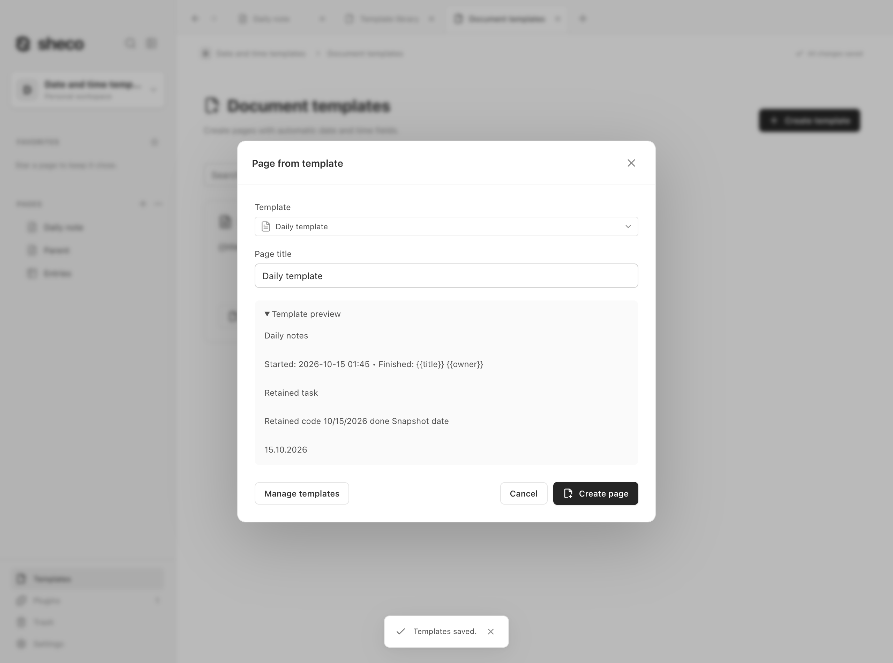
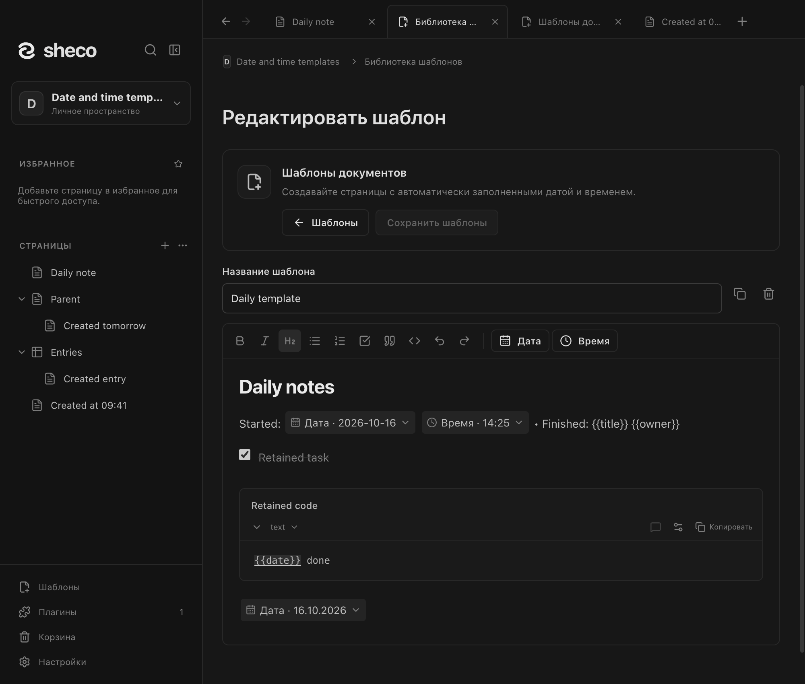

# Шаблоны документов / Document templates

Включите плагин в **Настройки → Плагины → Документы**. Над **Плагинами** в боковой
панели появится кнопка **Шаблоны**.

1. Откройте существующую страницу и выберите **⋯ → Сохранить как шаблон** или этот пункт в контекстном меню страницы в sidebar.
2. Копия страницы откроется в редакторе библиотеки. Поставьте курсор в нужное место
   и нажмите **Дата** или **Время**, чтобы вставить `{{date}}` или `{{time}}`.
3. Назовите шаблон и нажмите **Сохранить шаблоны**. Исходная страница не меняется.
4. Откройте **Шаблоны** и нажмите **Создать страницу** на нужной карточке.

Дата и время выглядят как компактные элементы прямо в тексте. Нажмите на элемент,
чтобы выбрать его формат; каждый элемент настраивается независимо. Дата и время
заполняются автоматически при создании страницы. Формат по умолчанию — дата по языку
интерфейса и время `HH:mm`. В списке представлены конкретные форматы, без
дублирующего пункта «Местный формат даты». Допустимы локальные токены, например
`{{date:YYYY-MM-DD}}` и `{{time:HH:mm:ss}}`. Выражения не вычисляются.
Только `date` и `time` являются полями: `{{title}}`, `{{project}}` и другие старые
обозначения остаются обычным текстом, без формы заполнения.

Страницу в корне можно создать через три точки в заголовке **Страницы** →
**Страница из шаблона**. Контекстное меню выбранной страницы создаёт вложенную
страницу; для базы данных — её запись. Новая страница получает содержимое и иконку шаблона. Она независима от исходной страницы и шаблона.

Общее меню **Страницы** открывается также по правому клику на пустом месте под
списком страниц. Отдельной строки **Новая страница** больше нет; плюс в заголовке
создаёт пустую страницу. Библиотека поддерживает поиск, редактирование, копирование и удаление
шаблонов. Редактор показывает один выбранный шаблон во всю ширину, без списка, поиска
и описания; кнопка **Шаблоны** возвращает в библиотеку.
**Создать шаблон** позволяет начать с пустого документа. Изменения редактора
сохраняются явно; при конфликте черновик остаётся доступен для проверки и перезагрузки.
Можно вставить шаблон в текущую страницу через `/template` или Ctrl/⌘+Shift+T;
отмена ничего не меняет, вставка отменяется одним действием Undo.

Сохранённые старые библиотеки и их метаданные остаются читаемыми. Пользовательские
поля и значения свойств больше не настраиваются и не применяются к новым страницам.
Выключение плагина скрывает кнопку и действия, сохраняя библиотеку. Шаблоны входят
в обычные снимки, резервные копии и экспорт рабочего пространства. Включение не
добавляет примеры. Пределы: 100 шаблонов, 1 МиБ на документ, 8 МиБ на библиотеку.

Enable under **Settings → Plugins → Documents**. **Templates** appears above **Plugins**
in the sidebar.

1. Open an existing page and choose **⋯ → Save as template**.
2. Its independent copy opens in the library editor. Place the cursor and use **Date**
   or **Time** to insert `{{date}}` / `{{time}}`.
3. Name it and **Save templates**; the source page is retained.
4. Open **Templates** and select **Create page** on the card.

Only date and time fill automatically using the creation-time clock. Compact inline elements
let you select a separate format for each occurrence. The focused editor has no catalog/search
sidebar or description field. Page context menus offer Save as template; right-clicking blank
space below the page list opens the same root creation menu as the Pages header. The
separate New page row is omitted; use the header plus/menu. Defaults are the
interface language's date and `HH:mm`.
Inline formats such as `{{date:YYYY-MM-DD}}` are supported without expression evaluation.
Title/custom tokens stay literal, without manual field forms. Existing legacy field/default
metadata is retained without applying property defaults. Root/child/database-entry creation
uses the ordinary page workflow, and templates survive disable/restart, backups and exports.
Search/edit/duplicate/delete and starting from a blank template remain available.

Screenshots use isolated synthetic macOS workspaces. They do not prove Windows runtime behavior.
See the [plugin catalog](../README.md).
