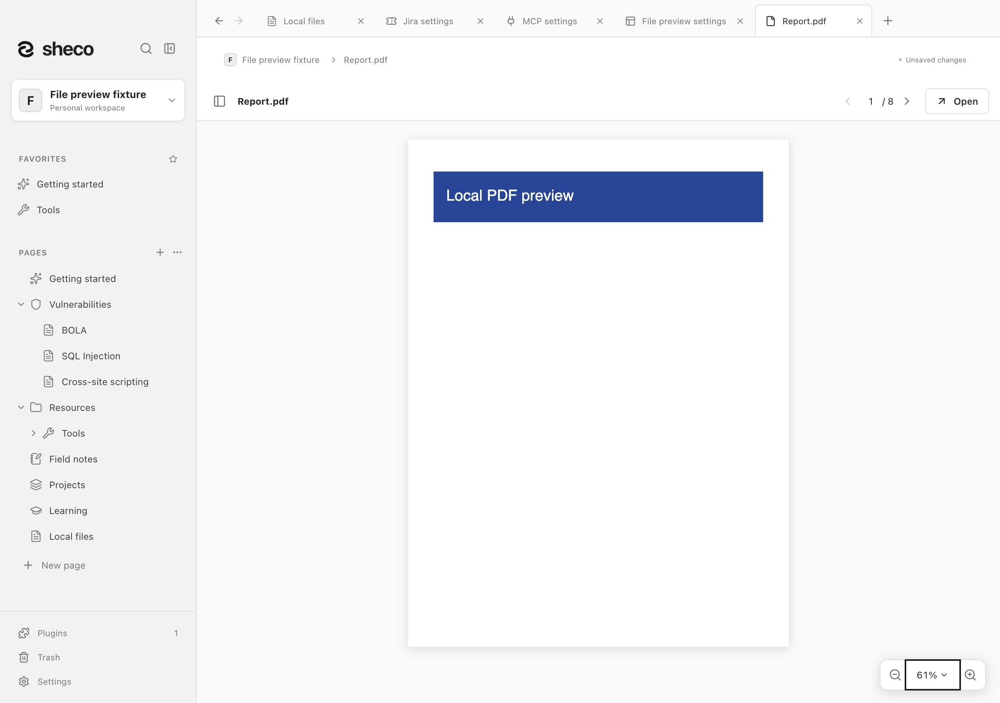
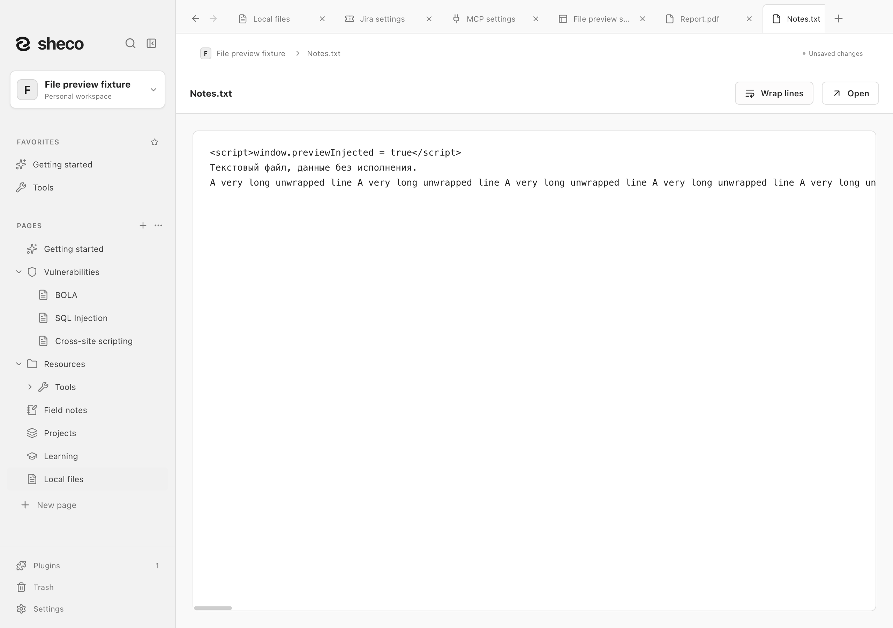
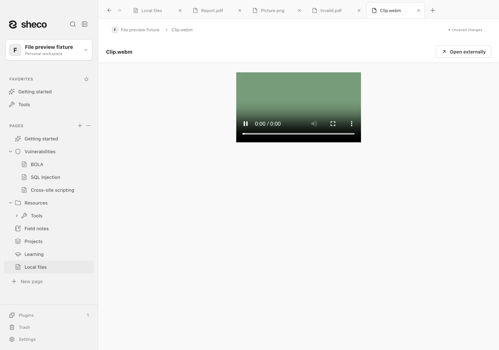
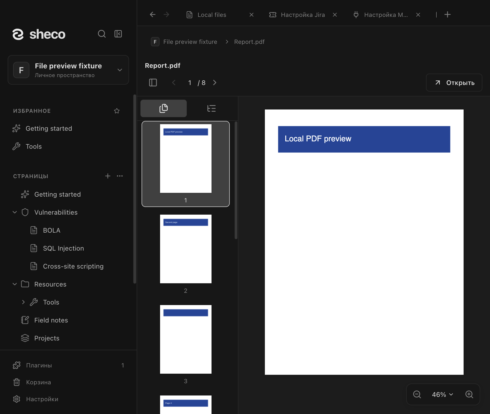
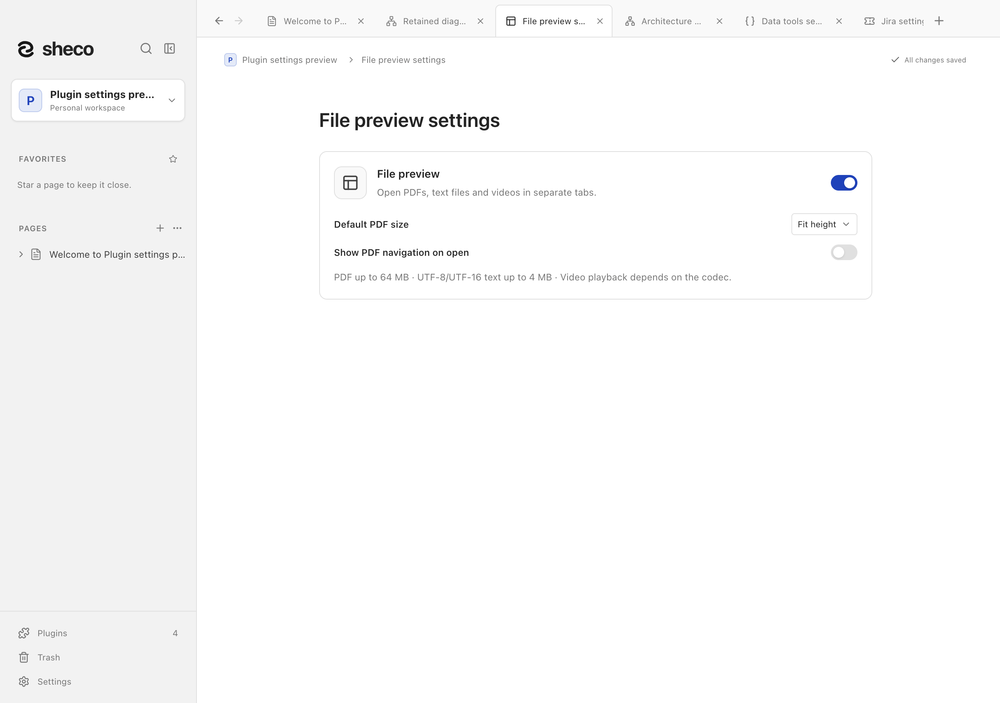

# Предпросмотр файлов / File preview

Включите **Настройки → Плагины → Предпросмотр файлов**. Нажмите вложение PDF,
текстовый файл или видео, чтобы открыть отдельную вкладку. Изображения остаются в заметке или открываются во внешнем приложении. Повторное открытие использует ту же
вкладку; открытые вкладки восстанавливаются после перезапуска.

PDF по умолчанию подгоняется по высоте. Номер страницы можно ввести вручную;
стрелки и Page Up/Page Down переключают страницы. Если жест прокрутки увеличенной страницы доходит до нижнего или верхнего края, его остаток и инерция останавливаются на текущей странице. Для перелистывания сделайте короткую паузу и прокрутите снова. Медленная прокрутка у нижнего или верхнего края сначала удерживает текущую страницу, а продолжение жеста переключает на соседнюю. Сильный или быстрый жест может пройти сразу несколько страниц; слабый остаток инерции не вызывает дополнительный переход. Компактная горизонтальная панель масштаба расположена справа внизу внутри области документа. Меню процента предлагает
подгонку по высоте/ширине и фиксированный масштаб. Жест двумя пальцами на
трекпаде увеличивает сам документ без исчезновения изображения во время перерисовки. Боковая панель содержит миниатюры страниц
и оглавление; внешние действия PDF не запускаются. Масштаб и страница сохраняются
при переключении вкладок в текущем сеансе. Текст показывается как обычный текст
с переключателем переноса строк и горизонтальной прокруткой внутри подложки; видео имеет кнопки воспроизведения.
Кнопка **Открыть во внешнем приложении** доступна в каждом просмотре.
Неподдерживаемые типы сохраняют открытие в стандартном приложении.
Выключение плагина закрывает его вкладки, сохраняя файлы.

Поддерживаются PDF, TXT/MD/CSV/JSON/LOG/YAML/TOML/INI/XML и MP4/M4V/WebM/OGV/MOV.
Текст ограничен 4 МиБ и кодировками UTF-8/UTF-16 с BOM; разметка и скрипты не исполняются.
Поддержка конкретного видеокодека зависит от Electron и ОС. PDF до 64 МиБ
отрисовываются локально через [PDF.js](https://mozilla.github.io/pdf.js/);
скрипты, встроенные действия и внешние ресурсы документа не исполняются.
Защищённый паролем или неподдерживаемый PDF откройте внешней кнопкой.
SVG и HTML не показываются внутри приложения. Плагин выключен по умолчанию.

Enable **Settings → Plugins → File preview** to open registered PDF, text and video
attachments in separate tabs. PDF has page navigation and zoom; video uses native controls
without autoplay. Images remain in the editor or open externally. PDF fits height by default, supports icon-based page/outline navigation and trackpad pinch with continuous rendering. A compact horizontal zoom dock sits at the bottom right inside the viewer. Scrolling a magnified page to an edge consumes that gesture and its momentum without turning the page. Pause briefly, then scroll again to turn it. Slow scrolling holds the current page at an edge before a continued gesture turns it. Strong or fast input can cross several pages; a weak momentum tail does not cause an extra turn. Unwrapped text scrolls inside its card. Configure opens a separate settings tab. Tabs are reused and
restored after restart; disabling the plugin closes tabs without removing files.
External opening remains available. PDF previews are local and limited to 64 MiB; password
protected PDFs and unsupported codecs can use an external app.

Скриншоты содержат только синтетические файлы из отдельного тестового пространства.

