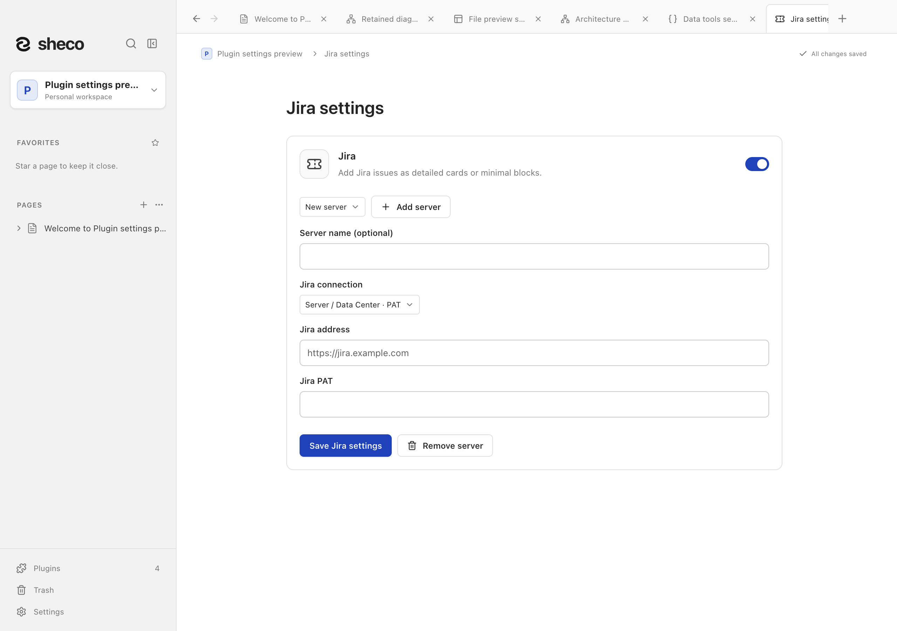
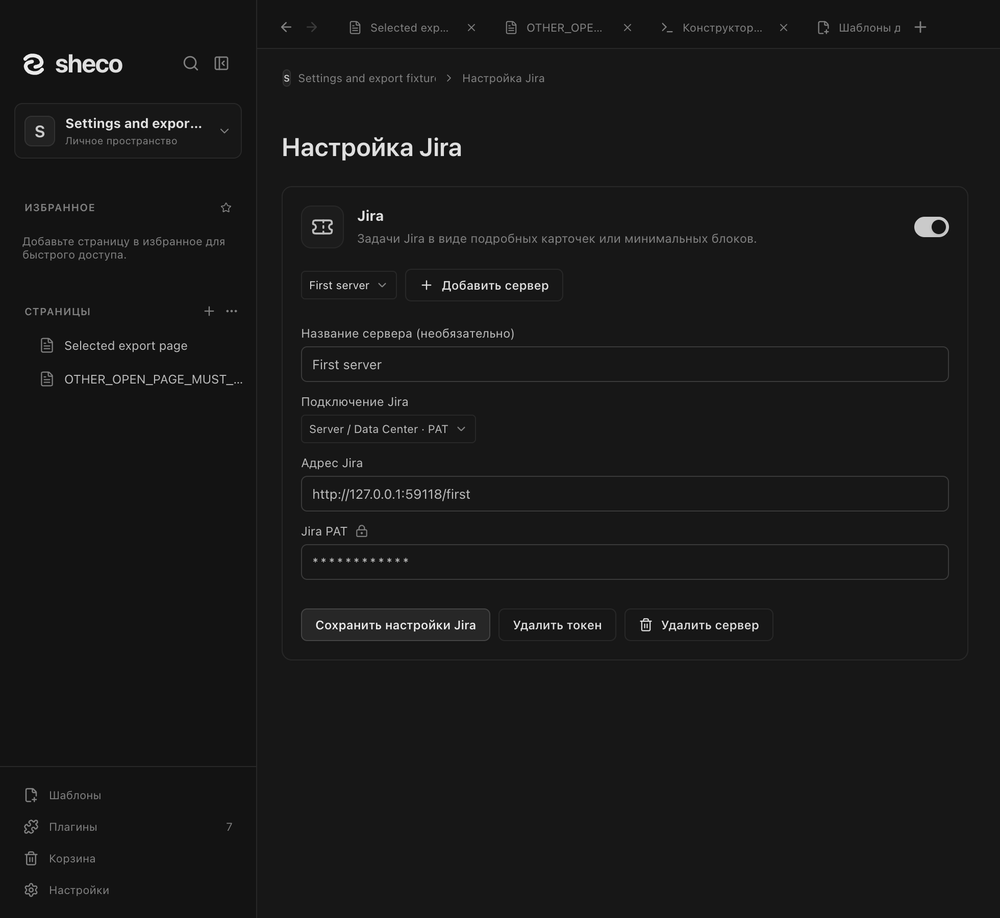
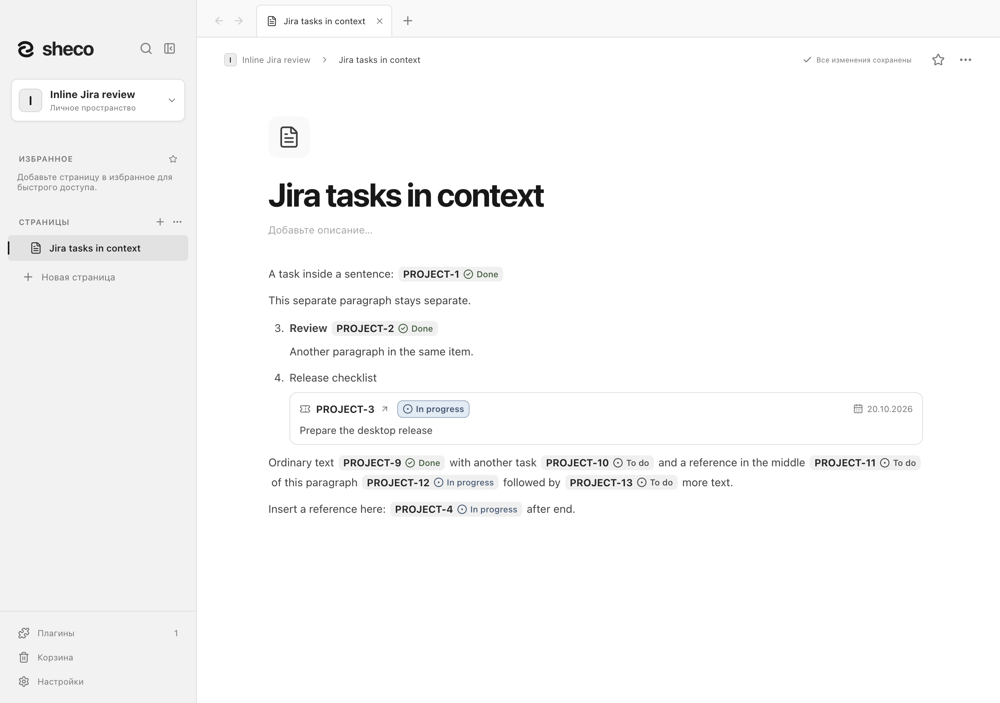
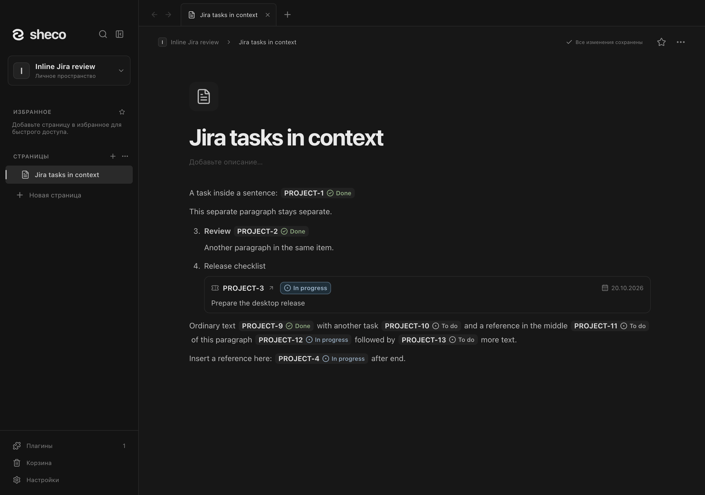
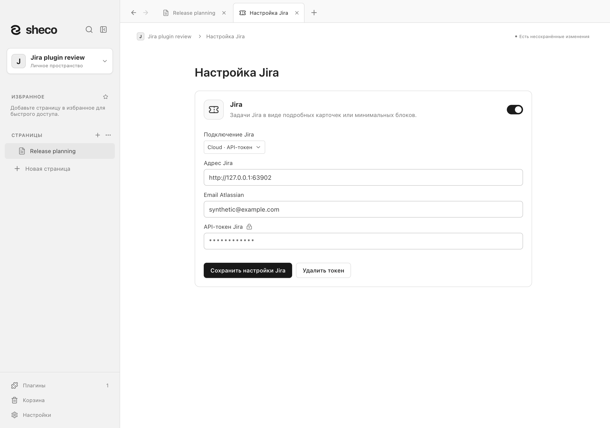
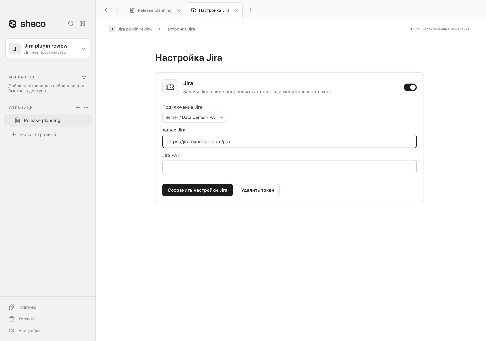
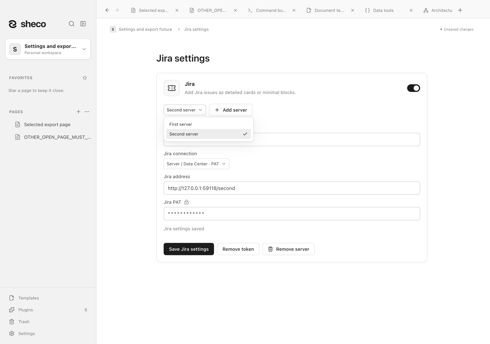
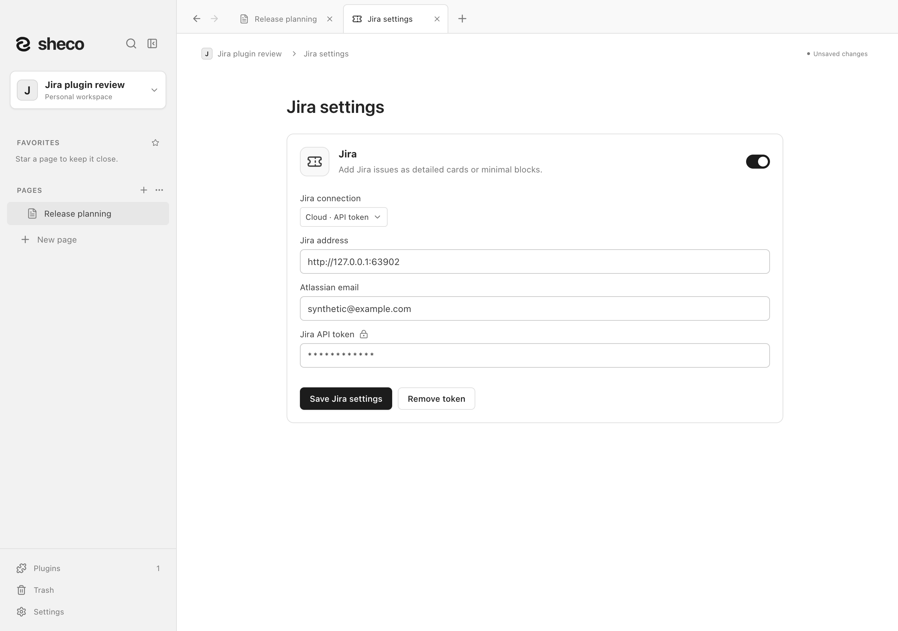
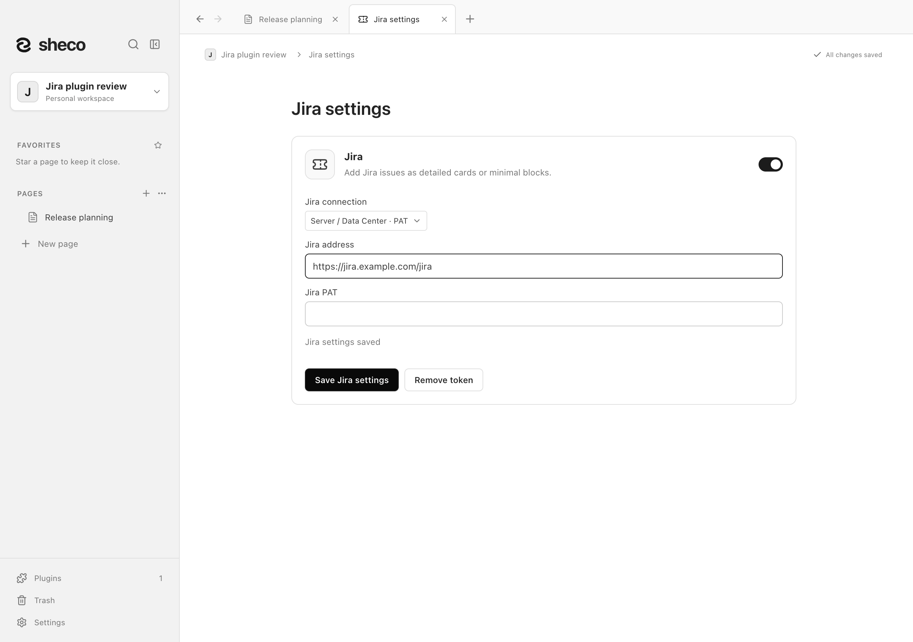

# Jira

Плагин добавляет в документ блок с задачей Jira. Подробный вид показывает
**PROJECT-NUM**, название задачи, статус и срок. Минимальный вид показывает
**PROJECT-NUM** и статус в компактной вставке внутри текста, включая пункты списков. Ключ задачи открывает её в браузере.

## Подключение и использование

1. Откройте **Настройки → Плагины** и включите **Jira**.
2. Нажмите **Настроить Jira** — откроется отдельная вкладка. Выберите подключение:
   - **Server / Data Center · PAT**: адрес сервера и персональный токен PAT.
     Поддерживаются контекстные пути, например `https://jira.example.com/jira`.
   - **Cloud · API-токен**: адрес сайта, email учётной записи Atlassian и API-токен без scopes.
   - **Cloud · API-токен со scopes**: те же поля для токена с ограниченными правами.
     Нужны права чтения задач; Cloud ID определяется автоматически при загрузке задачи.
     Адрес Cloud вроде `https://example.atlassian.net/jira/` автоматически приводится
     к `https://example.atlassian.net`. Удалённое подключение требует HTTPS; HTTP разрешён только для локального сервиса на этом компьютере.
3. Сохраните настройки. Сохранённый токен обозначается звёздочками и значком замка;
   для замены введите новый токен в это поле. Сам секрет обратно в интерфейс не загружается.
   **Добавить сервер** позволяет подключить до 20 серверов с отдельными токенами и необязательными
   названиями. Переключатель серверов сохраняет черновики каждого подключения.
   **Удалить сервер** удаляет только выбранное подключение и его токен на устройстве;
   остальные подключения и сохранённые задачи остаются.
4. Для карточки введите `/jira` и выберите **Задача Jira**. Для вставки внутри строки
   введите `/jira-inline` и выберите **Задача Jira в тексте** — команда работает
   в середине обычного текста и пунктов списков. Затем прямо в блоке укажите ключ (`PROJECT-123`)
   или ссылку на задачу с настроенного сервера.
5. Нажмите галочку **Добавить задачу** или Enter. Карандаш **Изменить задачу Jira** позволяет заменить выбранную задачу на месте; Escape отменяет замену. Вид каждого блока можно переключить через
   кнопку **Вид блока Jira**, которая появляется при наведении или фокусе.

**Обновить задачу Jira** повторно загружает данные. Загрузка и обновление выполняются
только по действию пользователя. Блок хранит последний снимок данных и доступен
без сети. Ошибка подключения не удаляет сохранённые данные. Смена вида и обновление
отменяются обычным Undo. Если задача не имеет срока, подробный вид показывает **Без срока**.

Для Server / Data Center плагин использует PAT в заголовке Bearer и
[`GET /rest/api/2/issue/{issueIdOrKey}`](https://developer.atlassian.com/server/jira/platform/rest/v10005/api-group-issue/).
Для Cloud используется [Basic authentication с email и API-токеном](https://developer.atlassian.com/cloud/jira/platform/basic-auth-for-rest-apis/)
и REST API v3. [Создать API-токен](https://id.atlassian.com/manage-profile/security/api-tokens)
можно в учётной записи Atlassian. Если при создании вы задавали scopes, выберите вариант
со scopes в Sheco. Он обращается к официальному шлюзу `api.atlassian.com`; Cloud ID
запрашивается у вашего сайта без токена. Отличия адресов для обоих видов токенов описаны
в [справке Atlassian](https://support.atlassian.com/atlassian-account/docs/manage-api-tokens-for-your-atlassian-account/).
Для токенов со scopes поддерживаются HTTPS-сайты `*.atlassian.net`.
Email должен принадлежать учётной записи, создавшей токен. Доступ к задаче зависит
от прав этой учётной записи и выбранных scopes.

Запрашиваются только `summary`, `status`, `duedate`. Плагин не изменяет задачи на сервере Jira.

## Данные и ограничения

Адрес, способ подключения и включение сохраняются в рабочем пространстве. Новые блоки
создаются в подробном виде через `/jira`, а `/jira-inline` вставляет ключ и статус
внутри строки. Вид меняется у самой задачи. При переключении между карточкой
и текстом сохраняются окружающий текст, форматирование и структура списков.
Текстовые вставки имеют одинаковые отступы слева и справа; компактная высота
и вертикальный зазор отделяют задачи друг от друга при переносе строк.
Ключ и статус находятся на одной нейтральной плашке без обводки;
цвет текста и значка обозначает статус без отдельной внутренней рамки.
Старые минимальные блоки преобразуются в текстовые вставки при открытии;
отдельные соседние абзацы остаются отдельными. Токен и email хранятся
отдельно на устройстве, зашифрованными средствами Electron `safeStorage`; они не входят
в `workspace.json`, экспорт, резервную копию рабочего пространства или MCP.
После переноса пространства на другой компьютер токен нужно ввести заново.
Кнопка **Удалить токен** удаляет сохранённый токен на этом устройстве; отозвать его
на сервере можно в Jira. Без защищённого хранилища сохранение токена недоступно. На macOS ключ защищён
Keychain, на Windows — DPAPI. Это защита файла на устройстве: она не заменяет защиту
учётной записи и системы; на Windows другие программы текущего пользователя могут
расшифровать данные. См. [модель защиты Electron](https://www.electronjs.org/docs/latest/api/safe-storage).

Отключение плагина сохраняет существующие блоки, но убирает команду вставки и блокирует
запросы к Jira. После смены адреса блока со старого сервера остаётся доступна его
исходная ссылка; для обновления нужно подключить тот же сервер.
Перенаправления REST-запросов не выполняются: используйте конечный адрес Jira.
Таймаут запроса — 15 секунд, максимальный ответ — 1 МБ.

Поиск использует ключ, название, статус и срок из сохранённого снимка.
Markdown сохраняет ссылку и данные выбранного вида. PDF сохраняет вид блока,
скрывая кнопки управления. Markdown оставляет ключ и статус минимальной вставки в одной строке с окружающим
текстом. Точный снимок, вид и адрес сохраняются в JSON и HTML
буфера обмена; импорт Markdown не восстанавливает блок Jira автоматически.
MCP может читать и редактировать снимки `jiraIssue` и `jiraIssueInline`, но не читает токены и не обращается к Jira.

## Скриншоты

## English

Enable **Jira** in **Settings → Plugins**, open **Configure Jira**, enter the server
address and connection type, then save. A saved token is shown as a fixed star mask;
type a new token to replace it. The secret is never loaded back into the interface.
Use **Add server** to connect up to 20 servers with separate tokens and optional names.
Choose a server when entering an issue key; a matching browse URL selects its configured server.
Refresh uses the snapshot's server. Removing one server deletes only its connection and device token,
preserving other servers and offline snapshots.
Server / Data Center
uses a PAT; Cloud uses the Atlassian account email and an API token. Choose the scoped
token option if you specified scopes when creating the token. Insert `/jira` on a page and enter
an issue key or a browse URL from that server. A detailed card shows the key, summary,
status and due date; a minimal reference shows the key and status within a sentence, including list items.
Use `/jira-inline` at the caret to insert it without splitting the paragraph. Hover or focus the block to
refresh it or change its view. Clicking the key opens Jira in the browser.

This plugin supports Jira Server / Data Center PAT authentication, including context
paths, and Jira Cloud Basic authentication with both unscoped and scoped API tokens.
Cloud navigation addresses ending in `/jira/` become the site root. Scoped tokens use
the fixed Atlassian API gateway; the Cloud ID is discovered without credentials from
the configured HTTPS `*.atlassian.net` site when explicitly loading an issue. It reads issues without changing them. Refresh is manual; saved snapshots remain
available offline. A failed request preserves the snapshot. View changes and successful
refreshes are undoable. Tokens and Cloud email are encrypted locally with Electron `safeStorage` and excluded
from workspace snapshots, exports, backups and MCP; enter the token again on another device.
Use `/jira` for a detailed card and `/jira-inline` for a key/status mention within text.
Switch views on the issue; the conversion preserves surrounding text and list structure.
Inline mentions have equal spacing on both sides and a compact height with clearance between wrapped lines.
The key and status share one neutral background without borders; semantic status text and icon colors remain visible.
Legacy minimal blocks become inline mentions when loading the document.
Copy/paste preserves the snapshot; Markdown keeps mentions within the sentence. Remote connections
require HTTPS; HTTP is allowed only for local test services. Requests have a 15-second
timeout and a 1 MiB response limit, and never follow redirects.

