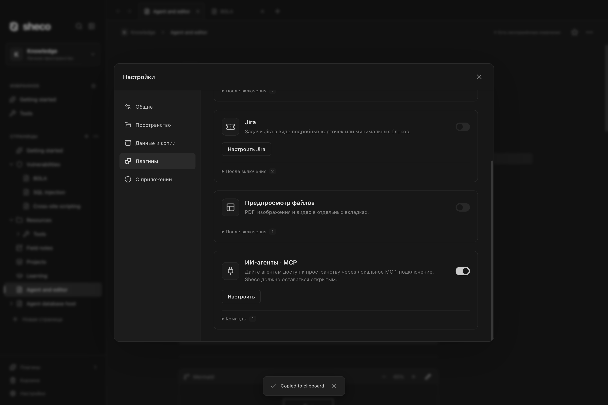

# ИИ-агенты · MCP / AI agents · MCP

Встроенный плагин подключает ИИ-клиент к локальному рабочему пространству.
Откройте **Настройки → Плагины → ИИ-агенты · MCP → Настроить**.
Настроить открывает отдельную вкладку; незавершённые поля сохраняются при переключении.
Включите подключение, выберите доступное пространство и скопируйте настройки
в клиент Streamable HTTP. Для записи отдельно включите **Разрешить изменения**;
по умолчанию доступ только для чтения. Sheco должно оставаться открытым.

Настройки, ключ, порт и ранее выбранные права сохранены при переносе MCP в плагины.
Они хранятся на устройстве в `mcp.json`, вне экспортов рабочих пространств.
Переключение пространства приостанавливает доступ до возвращения к выбранному.
Подключение слушает только `127.0.0.1`; новый ключ отзывает прежний.
Подробнее: [руководство пользователя](../../docs/user-guide.md#ai-agents-through-mcp).

The built-in plugin exposes a local workspace to MCP clients. Open **Settings → Plugins →
AI agents · MCP → Configure**, enable it, choose the authorized workspace and copy the
Streamable HTTP connection settings. Writes require a separate permission; default access
is read-only. The existing device-local configuration and permissions are preserved.

Скриншот из отдельного тестового пространства; секреты не показаны.

