# Архитектура проекта / Project architecture

Включите **Настройки → Плагины → Инструменты → Архитектура проекта**.
На обычной странице введите `/architecture` или найдите «архитектура» в меню `/`.
Команда создаёт **подстраницу** в дереве страниц и вставляет её живой предпросмотр
на исходную страницу. Нажмите стрелку **Открыть архитектуру** или выберите подстраницу
в sidebar, чтобы перейти к полноценному редактору.

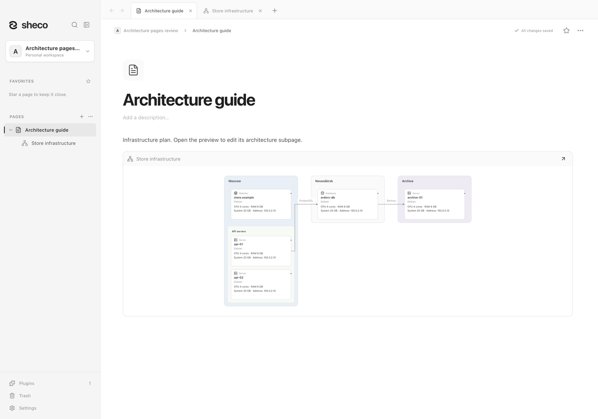

Каждая подстраница содержит одну самостоятельную архитектуру. Внутри редактора нет
выбора проектов, кнопки нового проекта или отдельного режима настройки.
Название проекта находится в небольшой верхней строке, а **Все площадки** — основной
заголовок с выбором площадки. Счётчиков объектов и площадок нет.
**Ресурсы проекта** меняет название и общий запас CPU (ядра), RAM и дисков (ГБ).
Именованные запасы, например `HDD Archive`, можно добавлять отдельно.
Фильтр **Все площадки** ограничивает вид, сохраняя общий остаток ресурсов.

## Работа мышью

- Правое нажатие на полотно, площадку или группу → **Создать объект →** → сервер,
  база данных или сайт. Объект сразу появляется; новую площадку и группировку
  создают из того же меню. Группа принимает серверы, базы данных и сайты одной площадки.
  При смене типа объект сохраняет свою группу.
- **⋯** у объекта или контекстное **Изменить свойства →** открывает выбор раздела:
  **Общие** (название, тип, площадка, группа, ОС), **Ресурсы** (название, CPU/RAM, диски),
  **Собственные параметры** (название и пары ключ–значение). Название доступно в каждом
  разделе. Все поля не занимают одно длинное окно.
- Изменения сохраняются автоматически. Некорректный или устаревший черновик остаётся
  в форме и блокирует переходы, пока вы не исправите его или не нажмёте **Сбросить черновик**.
  Площадки и группы также имеют небольшие формы названия и фона. Список объектов в
  свойствах группы не показывается; меняйте состав перетаскиванием.
- Диски добавляются из выбранного ресурса через **Добавить диск**: несколько дисков одного
  типа могут иметь разные имена. ОС выбирается из подсказок или вводится вручную в одном поле.
  Связи не редактируются в свойствах объекта.
- Перетаскивайте карточки, заголовки площадок/групп и выделенную рамкой выборку.
  Позиции привязаны к сетке; направляющие показывают совпадение границ.
  Заголовок переносит контейнер вместе с содержимым. Перенос на соседа меняет их местами.
  Объекты могут находиться **Без площадки**, прямо на полотне, или переходить между
  площадками. При переносе на другую площадку прежняя группа сбрасывается.
- Контекстное меню выделения группирует объекты любых типов одной площадки, дублирует или удаляет
  объекты. Синяя рамка отмечает только выбранные объекты; счётчик выделения не показывается. Пункт объединения скрыт для неподходящей выборки, например одного объекта.
  «Новая площадка» не показывается в меню объекта. Ctrl/⌘+D дублирует с отдельным расходом ресурсов и новыми идентификаторами;
  стрелки не копируются. Ctrl/⌘+C/V копирует и вставляет объекты или выбранную за заголовок группу вместе с её объектами. Новые копии имеют независимые идентификаторы, диски и расход ресурсов; вставка отменяется одним Undo. Удаление группы оставляет её объекты и связи.
- Маленькая точка у объекта создаёт стрелку без формы. Один клик по стрелке выделяет её
  и показывает маркеры для переноса начала/конца. Двойной клик по стрелке или подписи
  открывает поле текста и выбор стрелки отдельно в начале/конце и типа линии **Сплошная / Прерывистая / Точечная**; с клавиатуры используйте Enter/Пробел. Delete/Backspace удаляет выбранную стрелку. Допустимая цель подсвечивается.
  Самосоединения, повторные направленные пары, пустое место и Escape сохраняют прежнюю связь.
- Подпись можно перетащить вдоль своей стрелки. Для поворота выделите стрелку и потяните
  маленький круглый маркер над подписью. Поворот мышью и стрелками клавиатуры на маркере
  идёт с привязкой к углам, кратным 15°. Числовых полей в меню нет. Escape отменяет движение; Undo возвращает его одним шагом.
  Положение и угол сохраняются после перезапуска, в предпросмотре и SVG/PNG/JPG/PDF.
  Mermaid располагает подписи сам. Линия под дугой пересечения остаётся непрерывной, без белой подложки.
- **Отмена / Повтор**, Ctrl/⌘+Z и Ctrl/⌘+Shift+Z возвращают недавние изменения в текущем
  редакторе. Непрерывный ввод одного поля объединяется в одно действие.

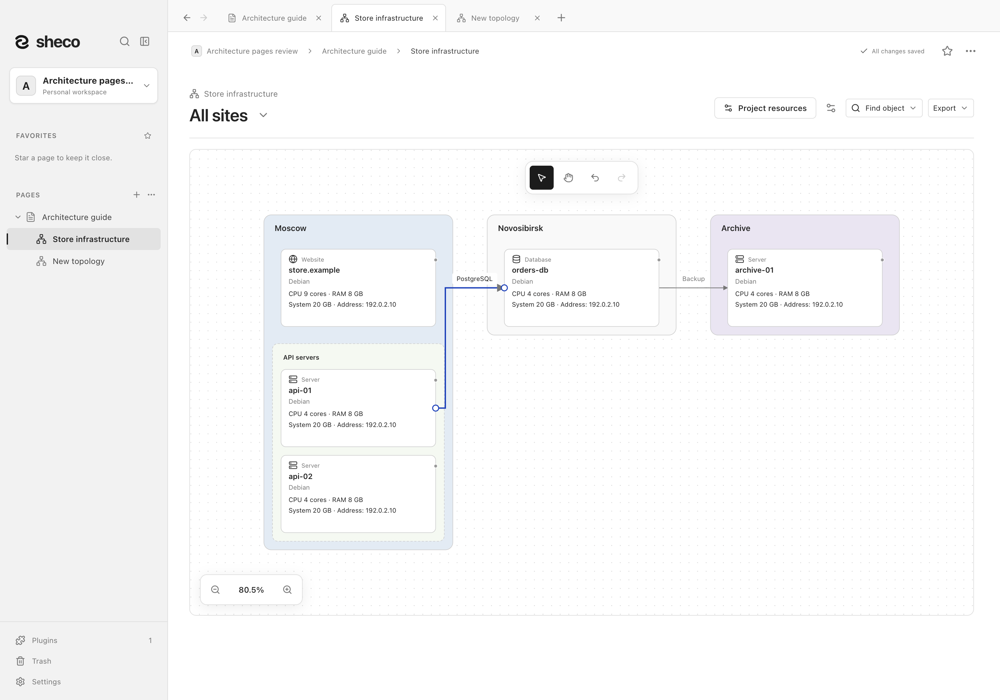

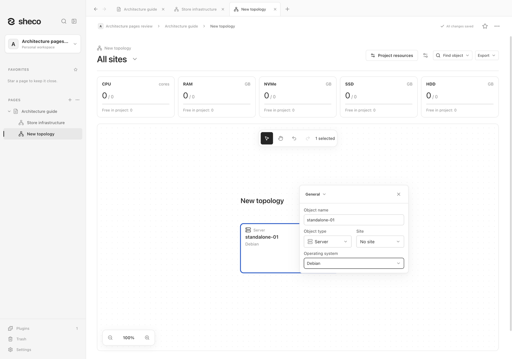

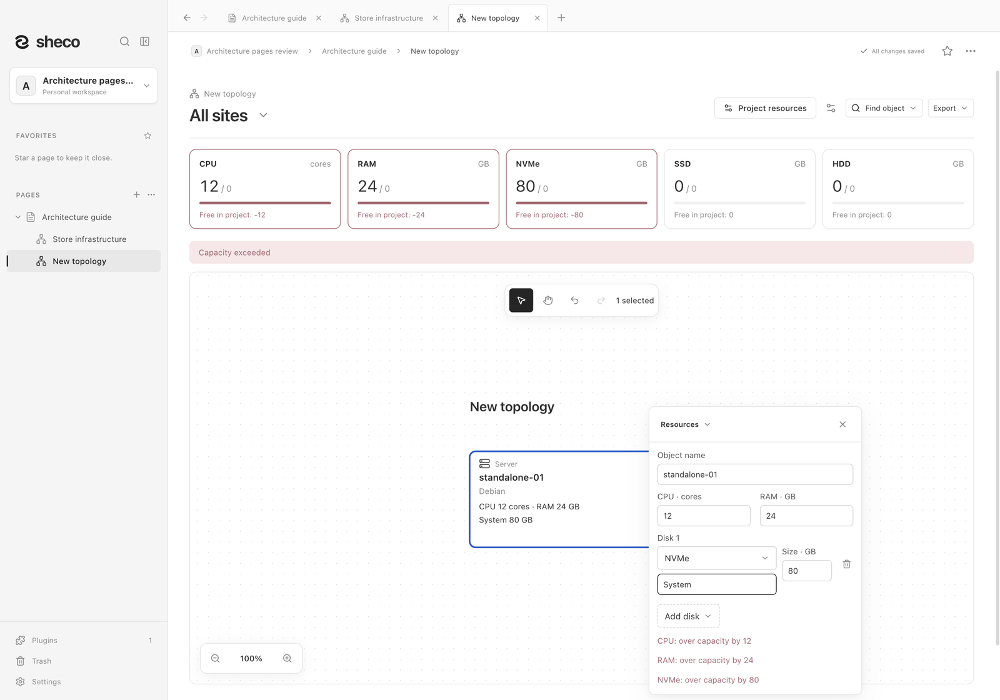

## Полотно и экспорт

**Рука**, средняя кнопка или удержание пробела перемещает полотно. Колесо/трекпад
перемещает вид; Ctrl/⌘+колесо и жест увеличения меняют масштаб под курсором.
Нажмите процент, чтобы увидеть всю схему. **Найти объект** находит и центрирует карточку.
Перетаскивание у края автоматически перемещает вид. Камера не сохраняется как данные проекта.
Инструменты выбора, руки и отмены/повтора находятся внутри полотна сверху по центру;
масштаб — снизу слева, по аналогии с Mermaid. Обе панели используют уменьшенные кнопки. Подписи расположены в разрыве линии, при необходимости поворачиваются на вертикальных участках. Пересекающиеся линии перешагивают друг через друга дугой. На тесных участках остаётся текст на самой линии, без замены на цифры. Меню связи закрывается кликом снаружи, изменение конца стрелки отменяется кликом по пустому полотну.

**Плагины → Архитектура проекта** открывает глобальные для пространства настройки вида новых схем: заголовок, ресурсы объектов и баланс. Они не меняют существующие схемы. Ресурсы в заголовке остаются кнопкой с текстом; поиск, экспорт и настройки отображения используют иконки без разделительной линии.

**Настройки отображения** сохраняют видимость заголовка схемы, мощностей и общего баланса.
Мягкие фоны площадок и групп помогают читать вложенность. Фильтр не меняет остаток;
превышение ресурсов допустимо при планировании и показано предупреждением.

**Экспорт → SVG / PNG / JPG** выгружает всю выбранную область, независимо от камеры,
с сохранением позиций. **Экспорт → Mermaid** открывает код с **Копировать Mermaid** и
**Скачать Mermaid**. Mermaid сохраняет топологию и вложенность, но расставляет узлы сам.
Markdown страницы содержит читаемую схему Mermaid, PDF — полный предпросмотр.
Для точного переноса данных используйте JSON/резервную копию пространства.

Предпросмотр показывает актуальную подстраницу. Удаление блока оставляет её в sidebar;
копия блока ссылается на ту же схему. Дублирование страницы создаёт самостоятельную копию,
а дублирование родителя копирует дочерние страницы и перенаправляет их предпросмотры.
Корзина и восстановление работают как для других подстраниц. При отключении плагина
страницы и предпросмотры остаются доступны для чтения. Старый список тестовых проектов
не переносится автоматически и не открывается отдельной вкладкой.

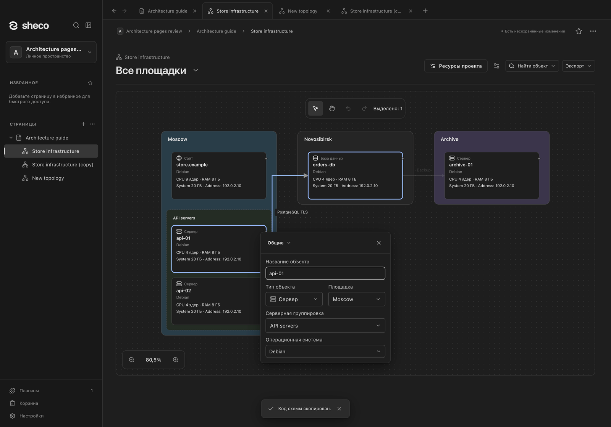

## English

Enable **Settings → Plugins → Tools → Project architecture**, then type `/architecture`
on a note. The command creates a child page in the sidebar and inserts a live preview into
its parent. Open that preview or sidebar child to edit one diagram, without a project library
or project switcher. **Project resources** controls the name and shared CPU/RAM/storage budget.
The project name is the small upper line; the site picker is the main heading, without counts.
It filters the view without changing global accounting.

Right-click to create an object through its type submenu, a site, or a group accepting servers, databases and websites on one site or directly on the root canvas. Type changes preserve membership.
An object's context/three-dot **Edit properties** submenu offers **General**, **Resources** and
**Custom parameters**. Each compact section includes its name and autosaves valid changes.
OS suggestions and custom text share one editable field. Group properties omit the member
list; drag cards to change membership. Unavailable grouping actions and New site in object
menus are hidden. Group selected objects is a separate top-level action for compatible selections; parent site/group deletion never appears for child objects. New site is offered only on blank canvas, and groups cannot contain nested groups. Invalid/stale drafts stay visible and block navigation/closing until corrected or reset.

Drag objects, marquee selections, or container headers on a grid with alignment guides and
swaps. Root objects need no site. Context Duplicate / Ctrl/⌘+D copies independent object
allocations, without arrows. Dots create unlabeled links immediately. A single arrow click selects
it for endpoint dragging; double-clicking the path or label edits its text. Enter/Space provides
keyboard editing. Endpoint handles reattach to highlighted valid targets. Card frames highlight explicit selection
only, with no related-card frames or selected-count text. Undo/Redo is session-local.

Hand/Space/middle mouse pans; wheel/trackpad pans and Ctrl/⌘-wheel/pinch zooms under the cursor.
Compact tools float at the top center inside the canvas; zoom/fit sits at the bottom left. Ctrl/⌘+C/V copies objects or groups with independent IDs/allocations and no arrows; Delete/Backspace removes a selected arrow. The connection menu independently selects both arrowheads and solid/dashed/dotted lines, and closes on outside clicks. Inline labels and jump curves clarify routes; actual text stays on its route without numbered callouts. Architecture settings in the Plugins menu controls defaults for new diagrams only.
Drag a label along its connection. Select the arrow and drag the small rotation handle above
its label to turn it in 15° steps; arrow keys on the focused handle use the same steps. The connection menu
has no numeric placement fields. Escape cancels either gesture and Undo restores it in one step.
Placement survives restart and SVG/raster/PDF previews; Mermaid supplies its own label layout.
Lines beneath crossing curves remain continuous, without opaque masks.
The percentage fits the full diagram; Find object centers a result. Export offers full-scope
SVG/PNG/JPG and a Mermaid Copy/Download viewer. Markdown contains Mermaid topology, PDF the
full preview, and workspace JSON/backups retain all diagram data.

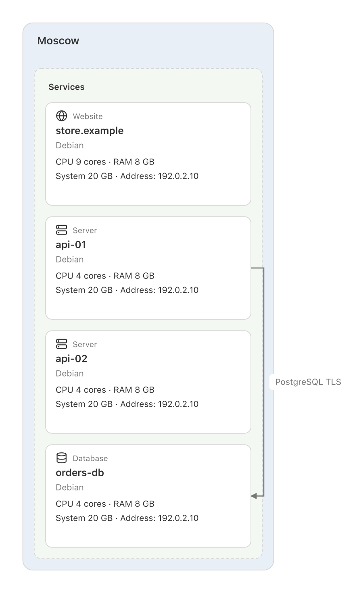

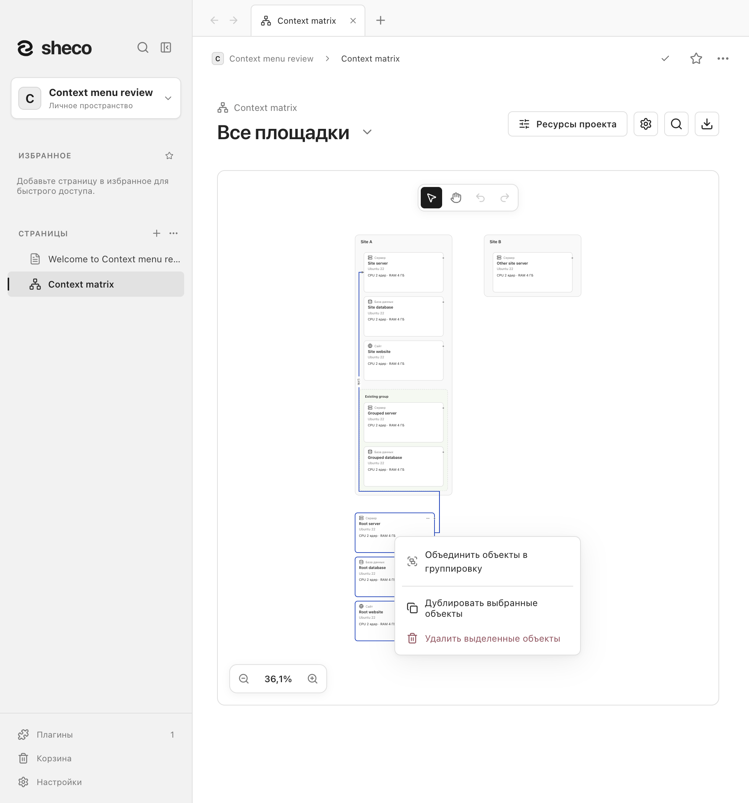

Deleting a preview retains its child; copying it references the same child. Duplicating a page
creates independent diagram data, and duplicating a parent rewrites its copied child references.
Plugin disable retains readable pages/previews; editing requires re-enabling. Legacy test project
libraries remain readable in snapshots but are no longer exposed or automatically migrated.

Screenshots use synthetic workspaces in the macOS source build. Regenerate current page/section
checks with `npm run test:architecture` after building; dense 500-object/1000-link checks use
`node scripts/architecture-dense-review.mjs`. Earlier library-based screenshots/suites are
historical and do not prove this page workflow or Windows runtime behavior.

## Compact controls and two-way links

Линия под дугой остаётся непрерывной. Дуги выбирают свободную сторону
и не заходят на наконечники, изгибы и соседние линии; если места недостаточно, дуга не рисуется.
Непрозрачной подложки нет, поэтому цвет площадки и горизонтальные линии сохраняются.
Наконечники остаются только у начала/конца связи, включая SVG/PNG/JPG/PDF.

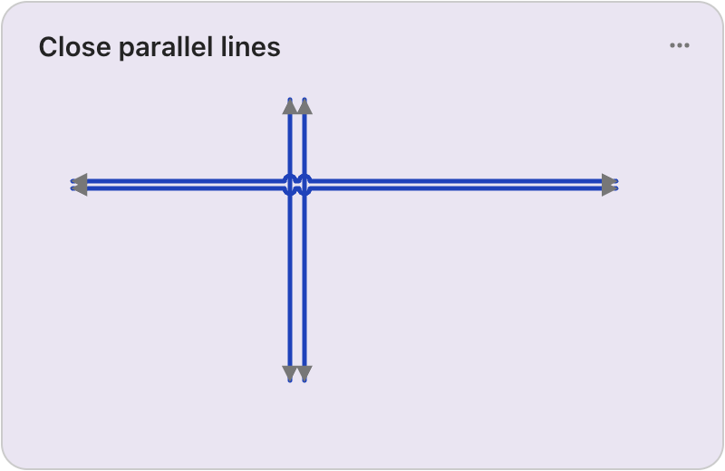

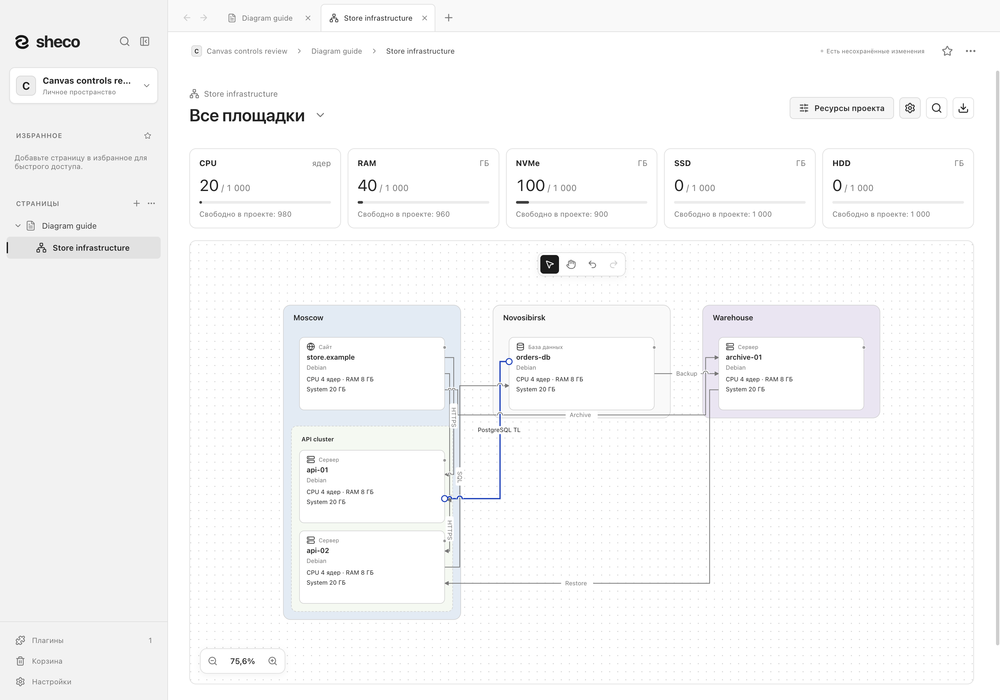

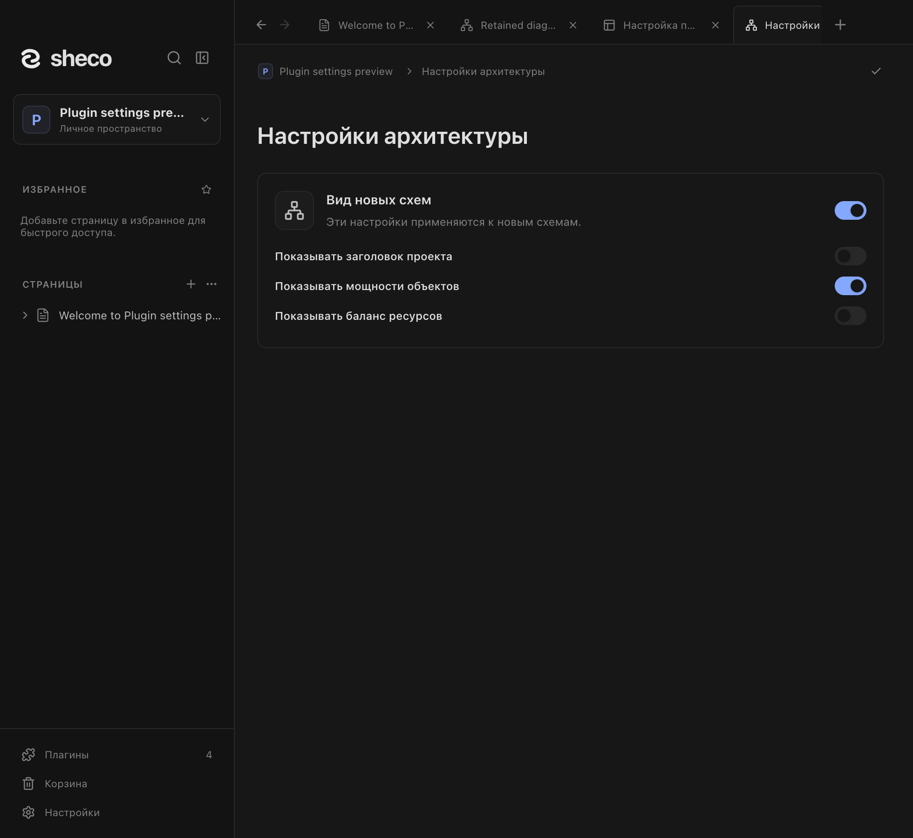

Переключатель в заголовке настроек включает и отключает плагин, сохраняя схемы и их
настройки. / The settings header switch enables or disables the plugin while retaining diagrams
and defaults.

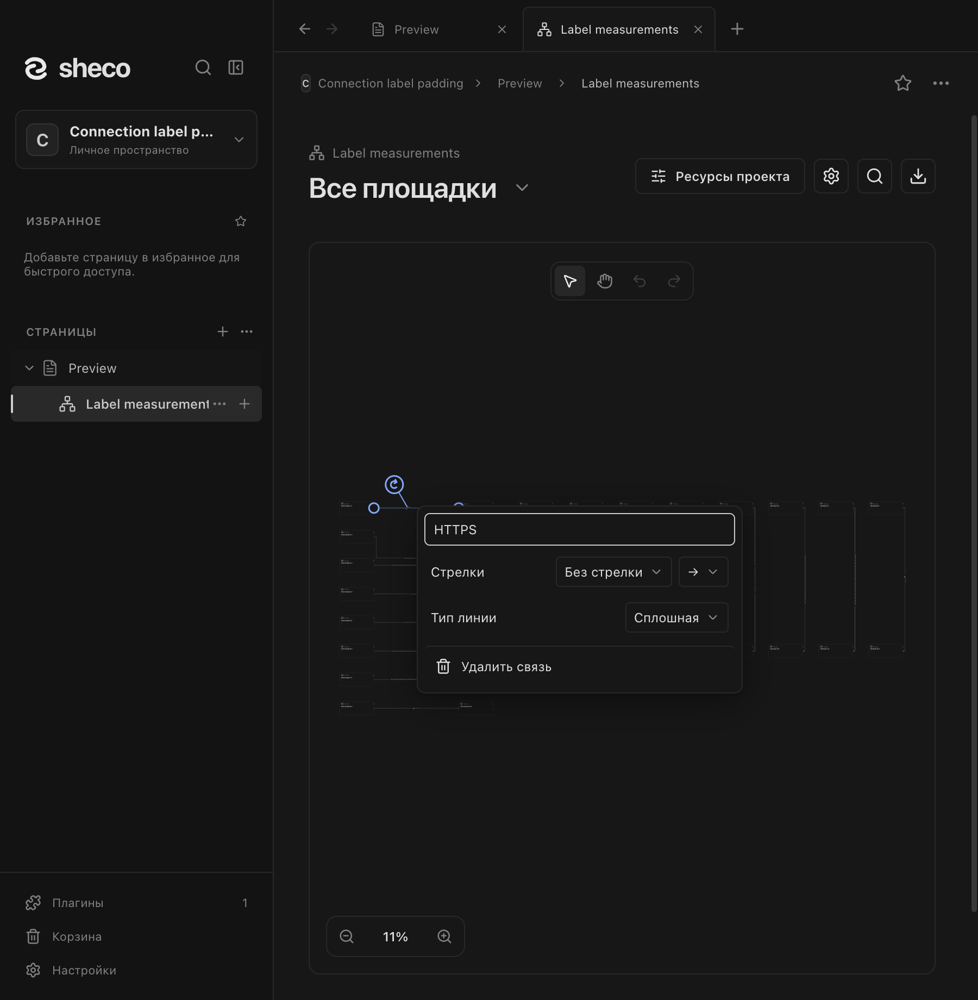

The controls review uses a fixture-local clipboard simulation and leaves the OS clipboard untouched:
`node scripts/architecture-controls-review.mjs`.

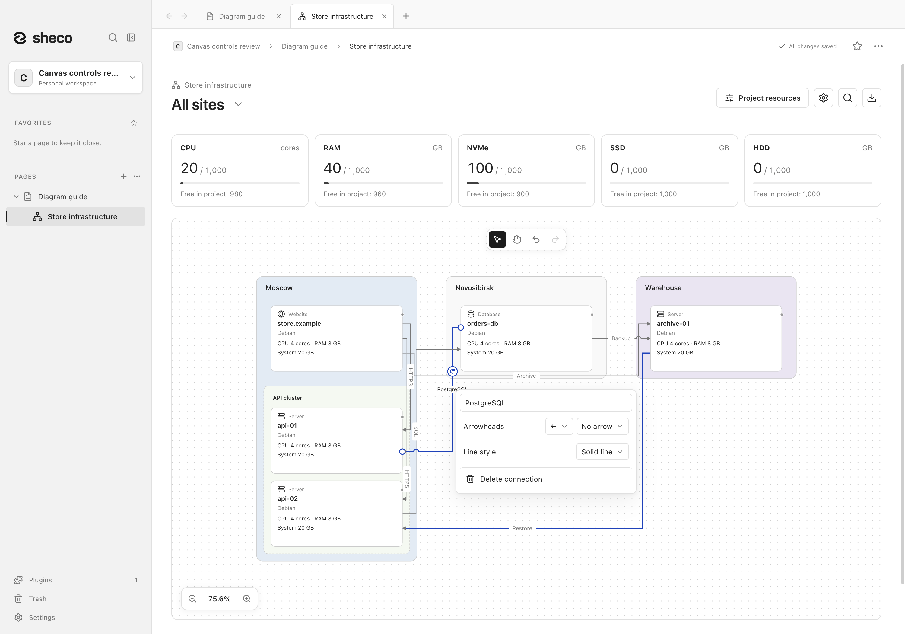

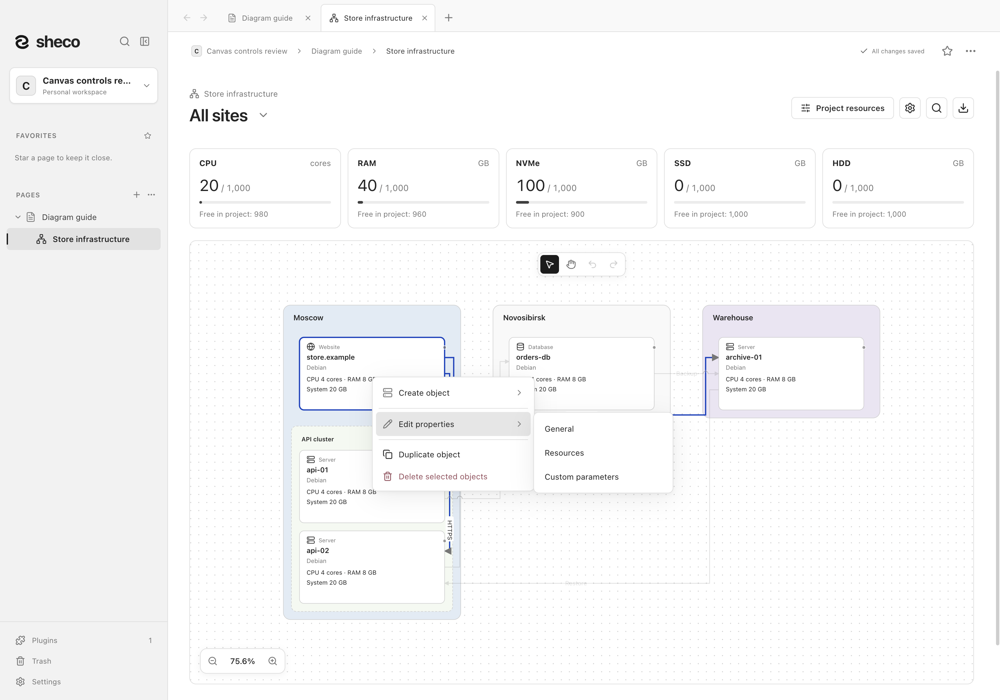
